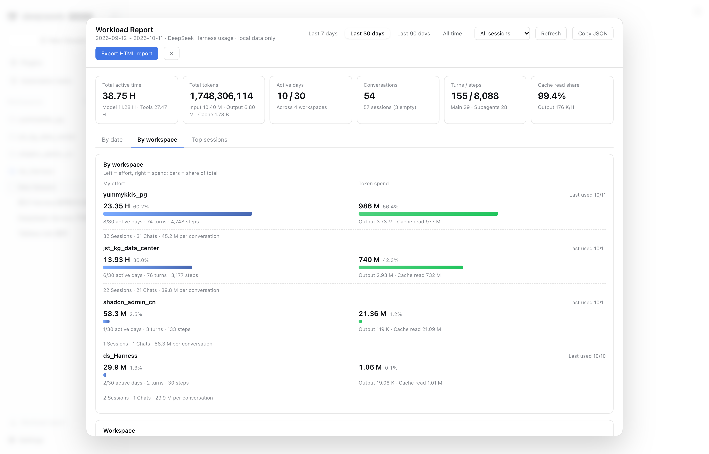

# Workload Report for DSH

> **See your effort and your token spend on the same picture** — by **date** and by **workspace**: a calendar heatmap, time-of-day analysis, workspace share, model usage, and a **one-click self-contained HTML report** you can send straight to a client.
> A DeepSeek Harness (DSH) plugin. Current version: **2.5.0**.

[](https://www.npmjs.com/package/dsh-workload-report)
[](./LICENSE)
[](https://github.com/tableau-China/dsh-workload-report/actions)
[](https://nodejs.org)

[中文](./docs/i18n/README.zh-CN.md) · [日本語](./docs/i18n/README.ja.md) · [Deutsch](./docs/i18n/README.de.md) · [Français](./docs/i18n/README.fr.md) · [Español](./docs/i18n/README.es.md) · [Русский](./docs/i18n/README.ru.md) · [Português](./docs/i18n/README.pt.md) · English

## What it is

DSH shows stats for the **current session**. This plugin adds the cross-session, cross-project, cross-time view: which dates and which workspaces your effort went to, which hours you were productive, which models consumed the tokens, and what it cost — plus a static report for clients, teammates or monthly reviews.

**Not only cost, but the work behind it.** Active time, active days and turns show what you actually did; tokens and estimated cost show what it consumed. Numbers use the same definitions everywhere, so the dashboard and the exported report agree.

## Who it is for

- **Freelancers and studios** who need to show a client where the time went — instead of saying "I was busy".
- **Developers using several models** who want active time, tokens, speed and estimated cost in one place, per date and per workspace.
- **Anyone preparing a monthly or project review** who would rather export one self-contained HTML report than build a spreadsheet.
- **Multi-machine setups**: merge usage from your laptop and desktop with the optional device sync.

## Install & entry point

```bash
# npm (published package)
dsh plugin add dsh-workload-report

# or straight from GitHub (pin a release tag)
dsh plugin --profile web add github:tableau-China/dsh-workload-report#v2.0.0

# or link a local checkout (development)
dsh plugin --profile web add link:$PWD
```

**DSH Desktop**: open **Settings → Plugins**, search for `dsh-workload-report`, and install it there — no command line needed. For `dsh web`, run the command above and restart the Web profile.

The entry appears at the **bottom of the sidebar**: **Workload report** — its label follows the DSH interface language (8 languages, see [Languages](#languages)). The built client bundle (`lib/client.js`) is committed, so installing from GitHub/npm needs no local build.

Uninstall: `dsh plugin --profile web remove dsh-workload-report`.

## Languages

The plugin has **no language setting of its own**: the dashboard, the exported HTML report, the AI-profile card (local fallback rules *and* model output), the sync dialogs and their server-side error messages all follow the **DSH interface language** (Settings → General → Language) and switch live.

| Language | Locale id | Dashboard | HTML report | AI profile | Sync dialogs |
| --- | --- | --- | --- | --- | --- |
| English | `en` | ✓ | ✓ | ✓ | ✓ |
| 中文（简体） | `zh` | ✓ | ✓ | ✓ | ✓ |
| 日本語 | `ja` | ✓ | ✓ | ✓ | ✓ |
| Español | `es` | ✓ | ✓ | ✓ | ✓ |
| Français | `fr` | ✓ | ✓ | ✓ | ✓ |
| Deutsch | `de` | ✓ | ✓ | ✓ | ✓ |
| Русский | `ru` | ✓ | ✓ | ✓ | ✓ |
| Português (Brasil) | `pt` | ✓ | ✓ | ✓ | ✓ |

- **Single source of truth**: every user-visible string lives in `src/locales/<lang>.json`; `zh.json` is the key baseline and `en.json` is the fallback. `npm run check:i18n` enforces identical key sets, key order and `{placeholders}` across all 8 languages, plus "no hard-coded copy in source" and "no dead keys".
- **Report language**: the exported report is rendered server-side with `?lang=<id>` (the dashboard passes the active language). `<html lang>` and date formatting follow the language; the methodology footer is translated too.
- **AI profile**: the model is explicitly asked to write the headline / dimensions / advice / risk in the active language; the deterministic local fallback uses the same dictionaries.
- **Sync / server messages**: user-visible results and errors carry a stable code + params; the client renders them from the dictionaries, so no raw server-side Chinese leaks into another language.
- **Adding a language**: copy `en.json`, translate, register it in `src/locales/index.js` — full workflow in [docs/i18n.md](./docs/i18n.md), terminology in [docs/i18n-glossary.md](./docs/i18n-glossary.md). On DSH versions without the locale service (pre-0.2.2), only `zh` / `en` are selectable and the plugin keeps working.

## Data sources & principles

- **Official interfaces only.** Session identity comes from `sessionQuery.listSessions()`; statistics come from the official projections (`sessionProjections`, `sessionProjectionCache`) and, when needed, the official `sessionQuery.observeSession()` cold read. Model and hourly-token dimensions use the official `sessionQuery.readSession()` event log.
- **No storage-format parsing.** The plugin never opens `*.jsonl.zstd`, never parses zstd/JSONL, and never reads the harness's internal projection-cache files. Formats can change between releases; the official seams are the contract.
- **Zero outbound requests by default.** All statistics stay on your machine. The plugin exposes read-only HTTP routes only, and writes only its own local index at `<DSH_HOME>/workload-report/index-v7.json` plus the AI-profile cache in the same directory (both safe to delete; they rebuild). The AI profile calls a model only after you click Generate.
- **Outbound-network cases**: the optional balance chip (`balance.enabled: true`, off by default), where the **host** calls the official `deepseekAccount` service, and the **AI user profile** (included by default, but only a manual click calls the model; aggregate statistics only). See [Privacy](#privacy).
- **No invented numbers.** Unreadable legacy sessions are excluded and counted in the UI; models without an official price show **—** instead of a made-up cost.

## Features (2.0.0)

- **Nine KPIs (two rows)**: cumulative active time (**net active**, waiting shown on a second line), total tokens (full integer you can verify), model-time share, active days, **conversations / turns** (one merged card, **steps no longer shown**), **output speed tok/s** (subtitle = TTFT), average output per request, cache-read share, and the most active model.
- **Daily usage trend**: calendar heatmap (Mon–Sun × Year-Week, colour and bar height = active time) or a bar chart; weekends use a different colour, the peak bar is always labelled, and every calendar cell, bar, weekday total and axis label has its own tooltip.
- **Time of day**: bars default to **token output** (switchable to **turns**); the dots above the bars show **human-message density**. Peak bars are highlighted and labelled; the legend sits on one row.
- **Workspace share**: Top 6 + others donut, switchable between **time** and **tokens**.
- **Model token share**: a compact donut on the dashboard; full model details live in the next tab.
- **Model usage tab**: treemap (area = token share, Top 8 + others), stacked daily trend (Top 6 models), a detail table (**speed tok/s / TTFT / provider** / share / requests / input / output / cache read / cache-hit rate / estimated cost — 11 columns, with ratio bars on speed and requests), metric chips (Token / requests / model time), click-to-filter, and official pricing links. Costs are estimated only for models with official public prices.
- **Top sessions and daily detail**: ratio bars in the main numeric columns (sessions: turns / steps / active / output; daily detail: conversations / turns / active / tokens) and sortable headers on the sessions table. The daily detail table is **expanded by default**, covers the last 31 days, and **paginates at 10 days per page** (no pager unless there is more than one page).
- **By workspace**: three bars per row — **sessions / turns · my effort · token spend** (one shared scale); the workspace list carries its own card head with a one-line hint (same structure as the model-usage page).
- **Export a self-contained HTML report**: one file with inline CSS and inline SVG, **no scripts and no external assets**; light/dark themes, custom title/note, optional `anonymize=1` to hide workspace names and session titles. The report mirrors the dashboard: nine KPIs, a calendar plus a **model token-share donut** (two independent cards whose widths align exactly with the time-of-day / workspace rows below), hourly density dots + turns mini-chart, ratio bars, and the same definitions. A **static range filter** at the top highlights the current range — visual only, with no links. Only official pricing pages are linked.
- **GitHub Star entry**: "GitHub logo + ★ Star" in the **top-right** of the panel, opening the repo in a new tab; deliberately **not** in the exported report (the report goes to clients, whose only external links are official pricing pages).
- **Theme and locale aware**: **data visualisation uses the Tableau 10 palette** (`src/palette.js`, identical in the dashboard and the exported report); UI chrome (buttons / tabs / links) keeps host theme tokens (`--dsw-*`) so it follows the harness light/dark theme. The dashboard, exported report, AI profile and sync dialogs are **localised into all 8 languages** shipped by DSH 0.2.2 (English, Chinese, Japanese, Spanish, French, German, Russian, Brazilian Portuguese) and follow the host language live — see [Languages](#languages).
- **AI user profile (included by default, manual trigger)**: a dedicated top-level tab at the **right end of the navigation** (blue-tinted, distinct from the other tabs); the Top sessions tab keeps its sessions table only. It shows a three-line notice first and calls the model only after you click Generate. It generates a headline + 4–6 numeric dimensions + 2–3 advice items + risk from **aggregate statistics only** (window = max(current range, 30 days)) — never conversations, titles, or paths. The same statistics fingerprint reuses the disk cache; any failure falls back to deterministic local rules. See [AI user profile](#ai-user-profile).
- **Fast open**: opening the panel triggers **zero** event-log reads (`readSession`); cold open 25 ms, warm open ~1 ms (measured on an isolated instance). Model folding is driven by background timers, never by opening the panel.

## What's new in 2.5.0

- **Six new interface languages**: Japanese, Spanish, French, German, Russian and Brazilian Portuguese — alongside English and Chinese. The dashboard, exported report, AI profile and sync dialogs all follow the DSH language live, with an English fallback for anything untranslated.
- **One dictionary source**: UI copy moved from a single JS file with two languages to per-language JSON dictionaries (`src/locales/*.json`, 398 keys) shared by the browser half, the Node half and the static report. `npm run check:i18n` guards key-set / key-order / placeholder parity.
- **The HTML report is language-aware**: `?lang=` on `/report.html` renders the whole report (including the methodology footer) in that language; `<html lang>` and dates follow it.
- **AI profile follows the language**: the model is told to write in the active language, and the deterministic local fallback rules are fully translated (whole-sentence templates with `{placeholders}` instead of string concatenation).
- **No Chinese server-side leaks**: sync / settings / credential results now return a stable `code` + `params`; the client renders them from the dictionaries (falling back to the server message only for unknown codes).
- **Data layer is language-neutral**: unknown workspace / model / provider / session-title labels are no longer baked into the API payloads — each surface renders its localised placeholder.

## What's new in 2.4.0

- **Correct device filtering**: select a device and every chart shows only that device (local included), not just the calendar.
- **Pulled data survives restarts**: the last pull is cached to disk, so other devices stay visible after a restart or offline.
- **Auto fallback**: a device that disappears from the sync sources is dropped from the filter (back to "all devices" if none remain).
- **Donut fixes**: colours now switch correctly and the legend no longer accumulates even when models share a name.
- **Short provider names** (`workbuddy-ai` / `auto` / `workbuddy`) with the full path in the tooltip.
- **Refresh really refreshes** (bypasses the host cache); **ESC** now goes to the sync dialog instead of closing the panel.

## Screenshots

**By date**: nine KPIs + calendar heatmap + time-of-day analysis with human-message density dots + workspace share


**By workspace**: three bars — sessions / turns · my effort · token spend, one shared scale



## Metric definitions

The full definitions live in **[docs/metrics.md](./docs/metrics.md)**. Durations use one language-neutral `H / M / S` format (like K/M/B for tokens).

- **Active time** = model time + tool time − waiting for user. It is **cumulative engine work**, not wall-clock time (concurrent sessions and subagents each add up). Waiting for user is tracked separately as `waitMs`.
- **Time of day** defaults to **token output** (switchable to **turns**), with human-message density dots on top. Sessions with unreadable event logs are excluded from the token chart and counted in the card.
- **Total tokens** = uncached input + output + cache read + cache write. **Conversations** = sessions with at least one step. **Attribution date** = the session's creation day in the selected time zone.
- **Model cost** is estimated from built-in official public prices; only models with an official price get a number, others show **—** (an estimate, never an invoice).
- **Output speed tok/s** = weighted `ΣdecodeTokens / (ΣdecodeMs / 1000)`, excluding time to first token. **TTFT** = `step/start → first token`.
- **Ranges**: the end is always today and the start is `max(window start, first active day)`, so the active-days denominator is always the real span. The calendar heatmap always covers full history.

## Configuration

Override any of these in the profile's `cordis.patch.yml` (all optional):

```yaml
- id: workload-report
  name: dsh-workload-report
  config:
    defaultDays: 7                 # initial range: 7 | 30 | 90 | all
    refreshMs: 30000               # index refresh interval (ms)
    snapshotCacheMs: 15000         # snapshot cache per query (invalidated by events/index/fold)
    modelFoldWarmupMs: 2000        # warm-up fold after the index is ready (never from opening the panel)
    modelFoldIntervalMs: 720000    # periodic fold maintenance (12 min)
    modelFoldIdleMs: 600000        # only refold a live session after 10 min without events
    modelRetryMs: 1800000          # retry failed rows after 30 min (never changes the status line)
    revalidateMs: 604800000        # index row TTL: re-validate after this long (default 7 days)
    revalidateRecentDays: 30       # only re-validate sessions active in the last N days; 0 = disable the optimization
    snapshotSwr: true               # after a live event, serve the previous snapshot and rebuild in background (false = old behaviour)
    snapshotStaleMaxMs: 600000      # max age of a snapshot served by SWR (default 10 min)
    defaultScope: all              # all | main | subagent
    modelUsage: auto               # auto | off (off = do not read event logs for model/hourly data)
    excludeWait: true              # false = keep 0.6.0 behaviour (no wait detection)
    waitTools:                     # tools treated as waiting for a human
      - ask_user_question
      - exit_plan_mode
    waitMinMs: 60000               # minimum interval to be treated as waiting (ms)
    activeModelMetric: requests    # requests | tokens | activeMs
    workspaceAliases:              # display names, useful in client reports
      my-shop-app: Retail Order System
    balance:                       # optional balance chip — OFF by default
      enabled: false               # true = host calls platform.deepseek.com (see Privacy)
      refreshMs: 300000            # balance cache TTL (ms)
    aiProfile:                     # AI user profile — included by default, manual trigger only
      enabled: true                # set false to hide the entry; opening the panel never calls a model
      provider: ""                 # empty = host agentDefaultModel selection
      model: ""                    # use together with provider
      timeoutMs: 60000             # AbortSignal.timeout(timeoutMs)
      minDays: 30                  # aggregate window floor (days): a 7-day board still profiles 30 days
      # deliberately no maxTokens: an output cap truncates the JSON; the plugin repairs it instead
      cacheTtlMs: 86400000         # fingerprint cache TTL (ms); 0 = no disk cache
```

The default model prices are built in and offline; `pricing.overrides`, `pricing.asOf` and `pricing.links` let you replace them if your contract differs. See [docs/models.md](./docs/models.md).

## Multi-device sync (2.0.0)

Running DSH on several machines? Merge their usage into one report. **Disabled by default** — with no `sync` config the plugin behaves exactly as before and makes zero outbound requests.

**No YAML needed.** Open the dashboard → **Device sync** (right end of the device-filter row) → **one large dialog opens directly** (the old sync page is merged into it, there is no second layer):

1. **Status icon next to the title**: `✓` configured and reachable, `!` configured but failing, `○` not configured / disabled / untested.
2. **Device name** at the top (global — set once, used by all four backends).
3. **Storage + enable switch**: Tencent COS / GitHub / Gitea / shared folder.
4. **Connection details** as "label on the left, input on the right", one field per row; **credentials** expanded by default.
5. **Connection & sync status**: probe result, last push / pull, registered devices, last test.
6. **"Test connection" lives inside the dialog** and saving runs a probe automatically, so the icon and status update immediately.
7. **Sync frequency**: every 6 hours (default) / every 12 hours / on every boot / manual only — applied immediately on save (timers are rebuilt). With *manual only*, "Push now" / "Pull now" appear right after the options.
8. One **"Save settings"** button writes the profile config, then the credentials, then probes once.

Prefer a config file (servers / CI)? That works too — see section 4 of [docs/sync.md](./docs/sync.md).

```yaml
- id: workload-report
  name: dsh-workload-report
  config:
    sync:
      enabled: true
      transport: cos          # cos | github | gitea | local
      cos:
        bucket: my-sync-1250000000
        region: ap-guangzhou
        secretIdFile: ~/.dsh/.cos-id    # 0600
        secretKeyFile: ~/.dsh/.cos-key  # 0600
```

| Transport | Best for | Credential |
| --- | --- | --- |
| `cos` | Tencent Cloud COS — low latency, near-zero cost | SecretId/SecretKey (sub-account scoped to `machines/*` of one bucket) |
| `github` / `gitea` | You already have a Git account | fine-grained PAT: `Contents: Read and write`, one repo only |
| `local` | No cloud account / corporate intranet | **none** — point at an iCloud / Syncthing / NAS folder |

- **Aggregate rows only**: per-session stats (id / time / path / duration / tokens / models). No conversation content, prompts, or attachments.
- **Machine identity is automatic**: read from `<DSH_HOME>/.anonymous-user-id`; override the display name with `sync.machineName`.
- **Conflict-free by construction**: each machine writes only its own key (`machines/{machineId}.json`).
- **Per-device filtering**: device chips above the KPIs, or `?machine=` on the API.
- **Built-in "Device sync" entry** at the right end of the device-filter chip row (not a top tab); it opens sync settings, credentials, device status and manual push/pull.
- **Use a private bucket/repo**: the payload carries absolute `cwd` paths. The UI no longer offers the "redact paths" toggle
  (its meaning was unclear and it was already off by default); if you need it, set `sync.redactPaths: true` in the config to hash them.

See [docs/sync.md](./docs/sync.md) for the full config reference and least-privilege policies.

## Version

The dashboard appends its version and build hash to the **definitions note at the bottom**:

```
Definitions: metric definitions in docs/metrics.md; all data stays local. · v2.4.0 · 9eadcd8
                                                                          └─ host commit hash
```

- The version comes from `package.json` via the host (`/sync`); it is never hard-coded in the client and is not rendered when unavailable.
- The build hash identifies *which build the page is running*: if it stays old after an upgrade, the browser cached the
  client bundle (restart DSH / hard refresh) — it does **not** mean the version bump was forgotten.
- It is plain selectable text, so you can paste that line in a bug report.
- Release-time check: `node test/check-release.mjs --tag vX.Y.Z` compares `package.json`, CHANGELOG and both READMEs
  and validates the tag; it runs in CI.

## Style and layout changes (2.0.0)

- **Equal initial height for all four tabs**: the panel is a fixed `92vh` frame and scrolls internally,
  so switching between By date / Model usage / By workspace / Top sessions no longer jumps the frame height.
- **Responsive report width**: full width on narrow screens, capped at 1450px on wide ones, with viewport-scaled
  side padding (it used to be a fixed 1120px, leaving large empty margins on big displays).
- **"Device sync" entry** now sits at the right end of the device-filter chip row instead of the top tab bar.
- **One shared range rule**: 7 / 30 / 90 days and All time all start at the first active day; a short history
  shows its real span (for example `5/5 days` instead of `5/30`).

## AI user profile

**Included by default, but only generated by a manual click; opening the panel never calls a model.** The profile lives on its own top-level tab, aligned to the **right end of the navigation** and tinted so it stands out from the other tabs; the Top sessions tab keeps the sessions table alone.

- **First-open notice**: before any result, a three-line panel explains that only the last N days of aggregates are sent (no conversation text / titles / paths), which provider/model will be used (host default when unknown), and that the model is called — and costs may apply — only after clicking **Generate profile**. The notice disappears once a result exists; the result card offers **Regenerate**.
- **Trigger**: opening the panel only runs a `probe` (no model call; `llm.prepareCall` stays at 0). The model is called when you click **Generate profile / Regenerate**; the button is disabled while generating.
- **Aggregate window**: the request always uses `max(current range, aiProfile.minDays)`; `minDays` defaults to **30**, so a 7-day board still produces a `days >= 30` payload. The result card says “Based on the last N days”, where N is the actual window.
- **What is sent**: a strict whitelist of 56 aggregate fields — range, net active / wait time, sessions and turns, the four token components and their shares, cache-hit rate, average session / turns / steps, four session-duration buckets, 24 hourly token buckets, five time bands (active + token shares), top 5 workspaces, top 5 models, workspace count / switches, model count / multi-model, weekend / night share, and a last-7-days vs previous-7-days trend. **Never** conversation content, session titles, cwd, paths, session ids, or event logs. The host asserts the key set is exactly the whitelist and recursively rejects private keys and path-like strings.
- **Prompt**: senior productivity analyst; every insight **must cite a number**, and generic advice is forbidden. The reply must be strict JSON (`headline / dimensions / advice / risk`), `temperature: 0.35`; **no `maxTokens`** is sent.
- **Parsing / truncation rescue**: clean JSON → code fence → lenient first-`{`-to-last-`}` extraction. When `finish.kind=length` or the text is clearly unfinished, the plugin closes unclosed strings / arrays / objects and parses again; success is marked `truncated: true` (card footer says “Output truncated; repaired and used”). Only an unrepairable result falls back, with the first 300 characters in `diagnostic.excerpt`.
- **Cache**: SHA-256 (first 16 hex chars) of the stable JSON of that whitelist (new fields participate automatically). The result is cached on disk next to the index (atomic `tmp` → `rename`, `PROFILE_CACHE_VERSION = 4`); an identical fingerprint returns the cache without another model call. `force=1` regenerates.
- **Failure = local rules**: missing `llm` service, not signed in / no models, timeout, empty output, or unparsable JSON all fall back to a deterministic **local rules** profile with the same shape (headline + 4–6 dimensions + 2–3 advice + risk, every insight still numeric, no network). A non-`stop` finish whose JSON can be repaired is used instead (`truncated: true`); only an unrepairable one falls back. The response always carries `source: "llm" | "local"` and a stable `code`; nothing is thrown to the UI.
- **Diagnosable**: failures also carry `diagnostic.error.{code,message,stage}` (the underlying error code is preserved; the message is redacted and capped at 300 characters) plus `route` / `precheck`; `/health` exposes `diagnostics.aiProfile` with the latest attempt. For debugging, `provider=` / `model=` query parameters override just that request (only when `enabled=true`; no config write, no cache write, no restart).
- **Not counted in this report**: the profile call is an auxiliary call outside any session, so it is **not** included in this plugin's token / cost report. The card shows that call's input/output tokens and generation time separately.
- **Not in the HTML report**: the static export intentionally omits the profile (see `docs/report-parity.md`); an AI judgment about a person does not belong in a file sent to a client or printed.

Full details: [docs/ai-profile.md](./docs/ai-profile.md).

## Read-only API

| Route | Description |
| --- | --- |
| `GET {apiPath}/snapshot?days=30&tz=Asia/Shanghai&scope=all` | Aggregated snapshot JSON (totals / byDay / byWorkspace / byHour / bySession / calendar / byModel / modelDaily / diagnostics) |
| `GET {apiPath}/export.json?...` | Same payload with a `content-disposition` header |
| `GET {apiPath}/report.html?days=90&theme=dark&anonymize=1&title=...` | Self-contained HTML report |
| `GET {apiPath}/profile?days=30&tz=...&lang=zh&probe=1` | AI user profile: `probe=1` only reports enabled / signed-in / model, never calls one; otherwise generates on demand; `days` is floored at `aiProfile.minDays` (30); `force=1` bypasses the fingerprint cache |
| `GET {apiPath}/profile?...&provider=...&model=...` | **Debug entry**: override the route for this request only (only when enabled; no config write, no cache write) |
| `GET {apiPath}/health` | Index diagnostics (sessions, checkpoint hits, cold reads, read failures, duration); `diagnostics.aiProfile` has the latest profile code / stage / error / route |
| `GET {apiPath}/balance` | Cached balance state for the toolbar chip; never touches the index |

Parameters: `from`/`to` (YYYY-MM-DD, take precedence over `days`), `days`, `all=1` (earliest active day → today), `tz` (IANA time zone), `scope`.

## Index & upgrading

- Index file: `<DSH_HOME>/workload-report/index-v7.json`; `INDEX_VERSION = 7`.
- Upgrading from 0.6.5 or earlier **rebuilds the index and re-folds event data on first launch** (the hour buckets and hourly token/human-message fields are versioned). The API returns progressively filled data with `indexing: true` while this runs.
- Deleting the index is safe: the plugin cold-reads historical sessions again. Cold reads use official interfaces and concurrency 8 (about 2 minutes for 300+ sessions on the author's machine).
- Very early **v0-format sessions** may not be readable at all. They are excluded from statistics and the UI reports how many; the time-of-day card shows **“Token 未计入 N 个会话”** when their token distribution cannot be read.

## FAQ

### How do I see my total token usage across all DSH sessions?

Install the plugin, restart DSH, and open **Workload report** at the bottom of the sidebar. The **Total tokens** KPI sums every session in the selected range (today / 7 / 30 / 90 days / all time); the daily table and the workspace and model tabs break it down. Unlike a per-session stats line, this view is cross-session, cross-project and cross-device.

### How is this different from a token or cost dashboard?

Token and cost dashboards answer "how much did it consume?". This plugin answers **"where did my effort go?"** — it measures **active time** (model time + tool time, with waiting-for-user time excluded), attributes it to **dates and workspaces**, and puts it next to token usage. You can see a 46%-of-effort project, a 3.7 B-token month, and a client-ready report — from the same data.

### Can I send the report to a client or my manager?

Yes. **Export HTML report** produces one self-contained file (inline CSS and SVG, no scripts, no external assets) that opens anywhere. Use `anonymize=1` to hide workspace names and session titles, and `title` / `note` to brand it. The report mirrors the dashboard: nine KPIs, calendar heatmap, model token share, time-of-day analysis, workspace share and detail tables — with the metric definitions in the footer, so the numbers are explainable.

### Can I merge usage from several computers?

Yes, optionally. Device sync merges per-session aggregate rows from several machines through **Tencent COS, GitHub, Gitea or a shared folder** (iCloud / Syncthing / NAS). It is **off by default** and only syncs the numbers — no conversation content, titles, prompts or attachments. Each device writes its own file, so there is nothing to merge by hand.

### Does the plugin send my data anywhere?

No, by default everything stays on your machine. The plugin registers **read-only** local HTTP routes, uses only official DSH interfaces, and writes only its own local index and cache. Two features can use the network and are opt-in: the balance chip (off by default) and the AI profile (only after you click Generate; it sends aggregate statistics only). The exported report is a local file.

### Which interface languages are supported?

The dashboard, the exported report, the AI profile and the sync dialogs follow the **DSH interface language** and are localized into all 8 languages shipped with DSH 0.2.2: English, Chinese, Japanese, Spanish, French, German, Russian and Brazilian Portuguese. Switching the language in **Settings → General → Language** switches the plugin live — no reload, no plugin setting.

### How do I install it in DSH Desktop or dsh web?

In **DSH Desktop**: Settings → Plugins → search `dsh-workload-report` → install. In **dsh web**: `dsh plugin add dsh-workload-report`, then restart the Web profile. You can also install from GitHub (`dsh plugin --profile web add github:tableau-China/dsh-workload-report#main`). The built client bundle is committed, so no local build is required.

## Documentation

| Document | What it covers |
| --- | --- |
| [docs/metrics.md](./docs/metrics.md) | Definitions: active/net/wait, time-of-day, tokens, calendar, workspaces |
| [docs/models.md](./docs/models.md) | Model attribution, grouping, cache-hit rate, peak/off-peak pricing and cost estimation |
| [docs/ui-conventions.md](./docs/ui-conventions.md) | Shared UI components, card heads, legend/status rules, tooltip rules |
| [docs/report-parity.md](./docs/report-parity.md) | Dashboard → report parity checklist, intentional differences, structural assertions |
| [docs/ai-profile.md](./docs/ai-profile.md) | AI user profile: whitelist payload, cache fingerprint, fallback codes, privacy |
| [docs/discoverability.md](./docs/discoverability.md) | How this project is made discoverable: keywords, channels, submission checklists, launch plan |
| [docs/i18n.md](./docs/i18n.md) | 8-language architecture, maintenance rules, how to add a language |
| [docs/i18n-glossary.md](./docs/i18n-glossary.md) | Terminology and translation rules for translators |
| [docs/preaggregation.md](./docs/preaggregation.md) | Pre-aggregation assessment: measurements, costs, trigger conditions (verdict: not needed yet) |
| [CHANGELOG.md](./CHANGELOG.md) | Version history and testing notes |
| [PROGRESS.md](./PROGRESS.md) | Decisions, measurements, environment gotchas and release notes |

## Privacy

All statistics stay on your machine. The plugin registers **read-only** HTTP routes only: by default no outbound requests, no telemetry, no user content collected. It writes only its own index cache plus the optional AI-profile cache; nothing else in your harness data is touched. The exported report may contain session titles unless you pass `anonymize=1`.

**Optional balance chip — off by default.** Only when you set `balance.enabled: true` does the host call the official `deepseekAccount` service: `getBalance()` makes the **host** request `https://platform.deepseek.com/api/v0/users/get_user_summary` (the account balance endpoint). It is opt-in and cached for `balance.refreshMs`. The top-up/usage links come from the service's local `getState()` and need no network. A failed or timed-out query shows an em dash with a top-up link — never an error dialog. The balance is rendered only in your own toolbar chip and is **never written into the exported HTML report**.

**AI user profile — included by default, manual trigger only.** Opening the panel / `probe` only reads enabled, sign-in state, and provider/model; it **never calls a model**. Only after you click **Generate profile** does the plugin call the `llm` service (and your configured model provider) with the aggregate whitelist described in [AI user profile](#ai-user-profile), always using a window of at least 30 days. No conversation text, titles, paths, session ids, or event logs are sent. The response is cached on disk in the plugin's own directory; the static HTML report never contains it. If the service is missing, you are not signed in, the call times out, or parsing fails, the card falls back to local rules and shows the reason — no error dialog. This side call is not included in the plugin's token / cost report. Set `aiProfile.enabled: false` to hide the entry and guarantee zero model calls.

## Development

| Command | Purpose |
| --- | --- |
| `pnpm add -D esbuild puppeteer-core` | Install build and browser-test dependencies (or point `ESBUILD_PATH` / `WL_PUPPETEER_DIR` at existing installs) |
| `node build.mjs` | Bundle `src/client/` into `lib/client.js` (ModuleLoader factory format) with esbuild |
| `node test/verify.mjs` | **1738 offline assertions**: aggregation semantics with one shared range rule, time zones, turn-based hour bucketing and conservation, hourly tokens by message time, human-message density, wait exclusion (all three rules + long-task exemption + `excludeWait:false` regression), index/read fallbacks, report structure parity, the AI-profile tab as a right-aligned navigation entry, the 30-day profile window, multi-device sync (payload / merge / credentials / settings / device filter / pull-cache persistence), output-speed and TTFT definitions, zero model calls on first open, i18n key alignment, balance states, and 8-language rendering (dashboard helpers / report / AI profile / prompt) |
| `./test/e2e-boot.sh 3299` | Boot an **isolated instance** (own DSH_HOME and port) without touching your running GUI |
| `node test/i18n.mjs` | **I18n dictionary checks** (85 assertions): key sets / order / placeholders / empty values / untranslated / hard-coded copy / dead keys across all 8 languages; `--lang de` checks one language |
| `node test/e2e-ui.mjs` | Real-browser E2E: calendar/bar switching, geometry, donuts, report export, time-of-day card |
| `node test/e2e-i18n.mjs` | Real-browser E2E in all 8 languages: injects `navigator.languages`, opens the panel and the HTML report, asserts copy against the dictionaries and saves screenshots |

CI runs `build.mjs` + `verify.mjs`, and fails if the committed `lib/client.js` differs from a fresh build.

## Compatibility

- DSH `0.2.x`, **including `alpha` prereleases** (developed and verified against `@deepseek-ai/dsh@0.2.1-alpha.2` and `0.2.2-rc.1`). The manifest declares `engines.dsh >= 0.2.1-alpha.0` with **no upper bound**, so upgrading DSH to a newer 0.x build does not exclude the plugin by version range; newer versions are allowed to load but only the versions above are explicitly verified. The plugin depends only on official interfaces (`sessionProjections` / `sessionProjectionCache` / `sessionQuery`) and Node built-ins, never on internal file formats.
- The first launch cold-reads historical sessions whose projection checkpoints are missing; the API returns progressively filled data with `indexing: true`, and restarts reuse the persisted index.
- Very early **v0-format sessions** may not be migratable/readable by the current harness. They are excluded from statistics and the UI reports how many.

## Author

**[XILEJUN](https://github.com/tableau-China)** · [Blog post (中文)](https://github.com/tableau-China/dsh-workload-report/blob/main/docs/blog.md)

## License

[MIT](./LICENSE)
