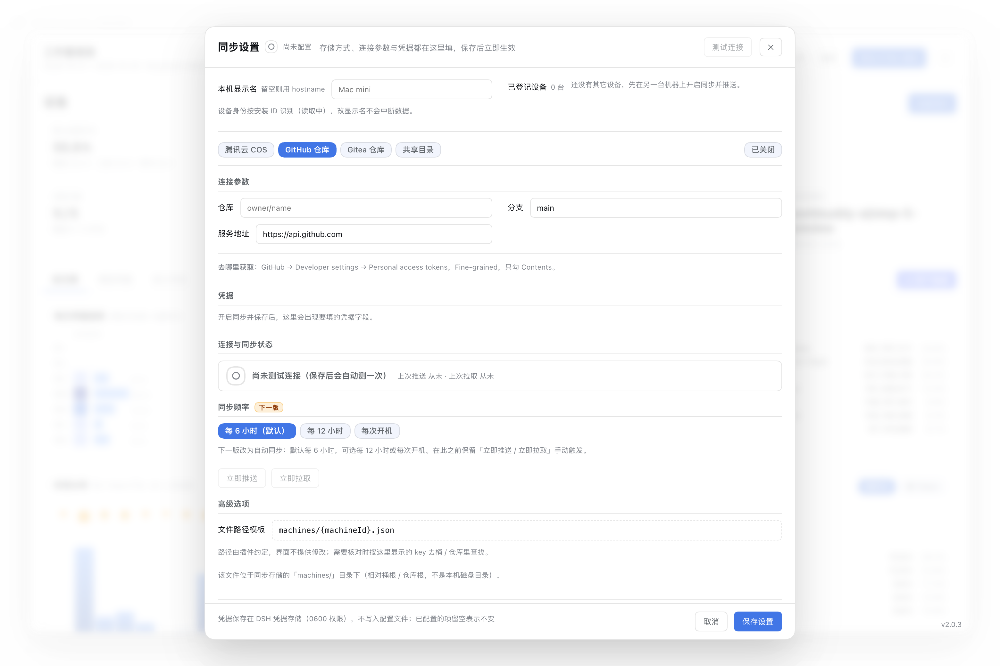

# TimeMirror for DSH · 工作量报告

> **把「我的付出」和「Token 消耗」放在同一张图上**——按**日期**与**工作区**看清时间投入到哪、Token 花在哪：日历热力图、时刻分析、工作区占比、模型用量，以及一键导出**可直接发给客户的自包含 HTML 报告**。
> DeepSeek Harness（DSH）插件。当前版本：**2.0.4**。

> **TimeMirror** 是我在 Mac App Store 发布的 macOS 时间分布应用；这个插件把同一件事带到 AI 协作场景。包名 / 仓库名沿用描述式的 `dsh-workload-report`，方便在 DSH 生态里被搜到；品牌仍是 TimeMirror。

[](https://www.npmjs.com/package/dsh-workload-report)
[](./LICENSE)
[](https://github.com/tableau-China/dsh-workload-report/actions)
[](https://nodejs.org)

中文 · [English](./README.md)

## 它是什么

DSH 自己只提供**当前会话**的统计行。这个插件补上跨会话、跨项目、跨时间的视角：日期与工作区分别投入了多少、几点最在状态、Token 被哪些模型消耗、大概花了多少钱，并能导出一份适合给客户 / 团队 / 月报的静态报告。

**不只看花了多少，更看做了什么。** 活跃时长、活跃天数与轮次回答「我做了什么」；Token 与费用估算回答「消耗了多少」。所有页面与导出报告使用同一套口径，数字互相对得上。

## 安装与入口

```bash
# npm
dsh plugin add dsh-workload-report

# 或从 GitHub 直接装（可指定版本 tag）
dsh plugin --profile web add github:tableau-China/dsh-workload-report#v2.0.0

# 或链接本地源码（开发用）
dsh plugin --profile web add link:$PWD
```

装完重启 Web profile，入口在**侧边栏底部**：**工作量报告**（英文界面为 **Workload report**）。构建产物 `lib/client.js` 已入库，从 GitHub / npm 安装**不需要本地构建**。

> **2.0.0 新增**：多设备用量同步（可选，默认关闭）与一轮样式 / 布局调整，详见下文「多设备同步」与「样式与布局调整」。
> **2.0.3**：AI 用户画像卡由蓝色改绿色（与周围蓝色控件区分，上下不再混淆）；看板面板宽度 1180→1600px 与报告页宽对齐；报告工作区列与条形列表左列改为随视口伸缩。
> **2.0.2**（并入 2.0.3）：同步设置与凭据合并进一个对话框、表单左右两列、「文件路径模板」收进「高级选项」、「抹掉路径」不再显示，右下角显示版本号。

卸载：`dsh plugin --profile web remove dsh-workload-report`。

## 数据来源与原则

- **只用官方接口。** 会话身份来自 `sessionQuery.listSessions()`；统计来自官方投影（`sessionProjections`、`sessionProjectionCache`），必要时用官方 `sessionQuery.observeSession()` 冷读兜底；模型与小时 Token 维度使用官方 `sessionQuery.readSession()` 事件日志。
- **不解析存储格式。** 插件从不打开 `*.jsonl.zstd`，不解析 zstd / JSONL，也不读 Harness 内部的投影缓存文件。格式会随版本演进，官方接口才是稳定契约。
- **默认零外发网络请求。** 统计数据全部留在本机；插件只注册只读 HTTP 路由，只写自己的本地索引 `<DSH_HOME>/workload-report/index-v7.json`；AI 画像只在你点击生成时旁路调用模型，并把缓存写到同目录（两者删掉都会自动重建）。
- **需要外发网络的场景**：可选余额 chip（`balance.enabled: true`，默认关闭，由**宿主**调用官方 `deepseekAccount` 服务），以及 **AI 用户画像**（默认包含，但只有点击「生成画像」才调用模型；只把聚合统计发给已配置的模型）。见「隐私」。
- **不编数字。** 读不出的早期会话会被排除并在界面写明数量；没有官方价的模型费用显示 **—**，不猜。

## 功能清单（2.0.0）

- **8 张 KPI**：累计活跃时长（**净活跃**，等待用户单列）、总 Token（完整整数，可核对）、模型费用、活跃天数、对话次数、轮次 / 步骤、缓存读取占比、最活跃模型。
- **每日用量趋势**：日历热力图（纵轴周一～周日、横轴 Year-Week，颜色与柱高＝活跃时长）或柱状图；周末异色，峰值柱始终标数值，日历格 / 每日柱 / 周几累计条 / 坐标轴都有各自的 tooltip。
- **时刻分析**：柱默认 **Token 产出**（可切 **轮次**）；顶部圆点＝**人类消息密度**。峰值柱高亮并标数值，图例单行显示。
- **工作区占比**：Top 6 + 其他的环形图，可在**按时长 / 按 Token**之间切换。
- **模型 Token 占比**：首页紧凑环形图；完整模型信息在独立页签。
- **模型用量页签**：treemap（面积＝Token 占比，Top 8 + 其他）、按日堆叠趋势（前 6 个模型）、明细表（占比 / 请求 / 输入 / 输出 / 缓存读 / 缓存命中 / 费用估算）、三口径 chips（Token / 请求数 / 模型耗时）、点击筛选，以及官方计费链接。费用只为有官方公开价的模型估算。
- **主要会话与按日期明细**：主要数值列都有比例条（会话：轮次 / 步骤 / 活跃 / 输出；日期明细：对话 / 轮次 / 活跃 / Token）；主要会话表头可排序。日期明细**默认展开**、覆盖最近 31 天，**每页 10 天分页**（只有一页时不显示分页控件）。
- **按工作区**：工作区条形列表有独立卡片头（标题 + 右侧一行说明），与「模型用量」页同构。
- **导出自包含 HTML 报告**：单文件、内联 CSS + 内联 SVG，**无脚本、无外部资源**；支持浅 / 深色、自定义标题与备注、`anonymize=1` 匿名化工作区与会话标题。报告与看板同口径：8 张 KPI、活跃日历 + **模型 Token 占比环形图**（两张独立卡片，列宽与下方「时刻分析 / 工作区占比」严格对齐）、小时密度点 + 轮次小图、表格比例条；顶部有**区间筛选器的静态样式**（当前区间实底高亮，纯视觉、无链接）；外链仅官方计费页。
- **主题与语言自适应**：颜色全部使用宿主主题 token（`--dsw-*`），自动跟随浅 / 深色；中英文文案逐键对齐。
- **AI 用户画像（默认包含，手动触发）**：导航**最右侧的独立顶层页签**（蓝色底强调，与其它页签可辨）；「主要会话」页只保留会话表。首开只显示三行提示，点「生成画像」才调用模型；只凭**聚合统计**生成「headline + 4–6 个维度（每条结论引用数字 + 证据）+ 2–3 条建议 + 风险提示」，绝不发送对话、标题或路径；汇总窗口固定为 **max(当前区间, 30 天)**；同一统计指纹直接复用磁盘缓存；输出被截断时先修复 JSON，修不好才降级为同构的本地规则版。详见 [AI 用户画像](#ai-用户画像)。
- **打开即快**：打开面板**零次**读事件日志（`readSession`），冷开 25 ms、热开约 1 ms（隔离实例实测）；模型折叠完全由后台定时器驱动，不因打开面板而触发。
- **多设备同步（2.0.0，默认关闭）**：多台机器的用量合成一份报告。COS / GitHub / Gitea / 共享目录四种存储任选，设置与凭据都在界面里填、保存即热应用；看板顶部设备 chips 可按设备筛选，按逐会话行合并，活跃天数不重复计天。见[多设备同步](#多设备同步200)。

## 界面截图

**按日期**：8 张 KPI + 日历热力图 + 含人类消息密度点的时刻分析 + 工作区占比


**按工作区**：左「我的付出」、右「Token 消耗」，两条 bar 同一比例尺


**导出的报告**：单文件，可直接发客户


<details>
<summary>深色主题报告</summary>


</details>

## 口径说明

完整定义见 **[docs/metrics.md](./docs/metrics.md)**；时长统一使用语言无关的 `H / M / S` 格式（与 Token 的 K/M/B 同理）。最容易被误读的几条：

### 活跃时长

- **活跃时长 = 模型时间 + 工具时间 − 等待用户**，是**引擎累计工作时间**，不是墙钟时长；并发会话与子代理各自累加，也不等于你坐在屏幕前的时间。
- **等待用户**单列为 `waitMs`，不计入活跃时长，并随索引持久化。官方 `totals.activeMs` 保留供核对：`netActiveMs + waitMs === activeMs`（±1 ms）。
- **等待三层判定**（单次工具区间必须 ≥ `waitMinMs`，且满足任一条件，才整段计为等待）：
  1. 工具名在 `waitTools` 白名单（默认 `ask_user_question`、`exit_plan_mode`）；
  2. `tool/call` → `tool/result` 之间夹着 `user/message`（人类输入夹层，任意工具适用）。
- **长任务豁免**：不在白名单、也没有人类输入夹层的长工具（编译 / 跑批）照常算工作；短于 `waitMinMs` 的交互不剔除，避免把正常确认切碎。
- 设 `excludeWait: false` 可完全关闭等待判定（行为与 0.6.0 一致）。

### 时刻分析

卡片有两种口径，另外叠一层人类消息：

- **Tokens（默认）**：每条 `assistant/message` 的 usage 按**消息时间**落到所选时区的小时桶；24 个桶之和等于会话官方 Token 总量（事件合计不一致时按整数回正）。
- **轮次**：该小时**开始**的会话数（看板其余部分的活跃时长仍按轮次开始时刻落桶）。
- **顶部人类消息密度点**：每小时 `user/message` 条数，圆点半径表示相对密度。
- 读不出事件日志的会话（极早期 v0、未回填、或 `modelUsage: off`）**不会伪造小时分布**：它们不计入 Token 时间图，卡片会写 **「Token 未计入 N 个会话」**；总量仍计入 KPI。

### Token、对话与日期

- **总 Token** = 未命中输入 + 输出 + 缓存读 + 缓存写。缓存读通常占绝大多数、单价最低，不要按输入价估算。
- **对话次数** = 至少产生 1 个 step 的会话数；零步会话（只打开没交互）单列，不计入该 KPI。
- **归属日期** = 会话创建时间在所选时区的自然日；跨天续聊仍记在创建那天。
- **模型费用**按内置官方公开价估算（DeepSeek 峰 / 谷两档，as-of 2026-10-13）。只有有官方价的模型才给数字，无价显示 **—**；运行时不联网取价。它是估算，不是账单。

### 统计区间

- **四档同一套算法**：区间终点恒为今天，起点 = `max(窗口起点, 最早活跃日)`。
  「全部」直接从第一天活跃开始；近 7 / 30 / 90 天在历史更长时仍是固定窗口，
  数据不足 N 天时同样从第一天活跃开始算——所以「活跃天数」的分母永远是真实跨度
  （新账号选近 30 天看到 `3/3 天`，而不是 `3/30`）。显式 `from` / `to` 与 AI 画像的固定窗口不受此截短。
- 日历热力图固定展示全部历史，不随顶部区间筛选变化。

## 配置

在 profile 的 `cordis.patch.yml` 里覆盖（全部可选）：

```yaml
- id: workload-report
  name: dsh-workload-report
  config:
    defaultDays: 7                 # 初始区间：7 | 30 | 90 | all
    refreshMs: 30000               # 索引刷新间隔（毫秒）
    snapshotCacheMs: 15000         # 同参数快照缓存（事件/索引/折叠完成立即失效）
    modelFoldWarmupMs: 2000        # 索引就绪后预热折叠；打开面板不触发
    modelFoldIntervalMs: 720000    # 例行折叠维护（12 分钟）
    modelFoldIdleMs: 600000        # 活会话空闲 10 分钟才重折
    modelRetryMs: 1800000          # 失败行 30 分钟后低频重试（不改状态行）
    revalidateMs: 604800000        # 索引行有效期：过期后重校验（默认 7 天）
    revalidateRecentDays: 30       # 只重校验近 N 天有活动的会话；0 = 关闭该优化（回到 1.0.3 行为）
    snapshotSwr: true               # 活会话事件后仍返回旧值并后台重建（false = 旧行为）
    snapshotStaleMaxMs: 600000      # SWR 可返回的旧值最大年龄（默认 10 分钟）
    defaultScope: all              # all | main | subagent
    modelUsage: auto               # auto | off（off = 不读事件日志，不做模型/小时维度）
    excludeWait: true              # false = 回到 0.6.0 行为（不判定等待）
    waitTools:                     # 视为「等人」的工具
      - ask_user_question
      - exit_plan_mode
    waitMinMs: 60000               # 判定等待的最小区间（毫秒）
    activeModelMetric: requests    # requests | tokens | activeMs
    workspaceAliases:              # 工作区显示名，给客户看时很有用
      my-shop-app: 零售订单系统
    balance:                       # 可选余额 chip —— 默认关闭
      enabled: false               # true 时宿主会访问 platform.deepseek.com（见「隐私」）
      refreshMs: 300000            # 余额缓存时长（毫秒）
    aiProfile:                     # AI 用户画像 —— 默认包含，但只手动触发
      enabled: true                # 显式 false 才隐藏入口；打开面板绝不调用模型
      provider: ""                 # 空 = 使用宿主 agentDefaultModel
      model: ""                    # 与 provider 成对配置
      timeoutMs: 60000             # AbortSignal.timeout(timeoutMs)
      minDays: 30                  # 汇总窗口下限（天）：看板选 7 天时仍按 30 天统计
      # 刻意不提供 maxTokens：输出上限会截断 JSON，截断时由插件修复括号抢救
      cacheTtlMs: 86400000         # 指纹缓存时长（毫秒）；0 = 不落盘
```

默认价目内置、离线可用；如合同价不同，可用 `pricing.overrides` / `pricing.asOf` / `pricing.links` 覆盖，详见 [docs/models.md](./docs/models.md)。

## 多设备同步（2.0.0）

多台机器各跑一份 DSH？把它们的用量合成一张报告。**默认关闭**，不配置时插件行为与之前完全一致、零外发请求。

**不需要改 YAML。** 打开看板 → 设备筛选行右侧「设备同步」→ **直接弹出一个大弹窗**（原「设备同步」页已并入，没有第二层）：



1. **标题旁的状态图标**：`✓` 已配置且连接正常，`!` 已配置但连不上，`○` 未配置 / 未开启 / 未测试；
   状态区是**一行**（大徽标 + 结论 + 上次推送 · 上次拉取）。
2. **本机显示名 + 已登记设备**（最上方，并列）：显示名是全局项，一次设置对四种存储方式都生效；
   设备按**安装 ID** 识别，改名字不会中断历史数据（id 变了才会拦截并提示）。
3. **存储方式 + 开启同步**：腾讯云 COS / GitHub / Gitea / 共享目录。
4. **连接参数**「左标题 + 右输入框」一行一个；**凭据**默认展开、每个字段一行。
5. **连接与同步状态**：一行大图标 + 结论 + 上次推送 / 上次拉取（失败时多一行原因）。
6. **测试连接就在弹窗内**：头部按钮可随时重测；**保存后自动测一次**，结果直接反映在图标与状态区。
7. **高级选项**直接显示「文件路径模板」的**只读** key（如 `machines/<id>.json`），并说明它位于同步存储的
   `machines/` 目录（相对桶根 / 仓库根，不是本机目录）。
8. **同步频率（本版预留）**：默认「每 6 小时」，「每 12 小时」「每次开机」置灰标「下一版提供」；
   自动同步上线前仍可用「立即推送 / 立即拉取」手动触发。
9. 点唯一的「保存设置」：先写 profile 配置（热应用），再写凭据并自检一次连接。

想用配置文件的场景（服务器 / CI）也支持，见 [docs/sync.md](./docs/sync.md) 第四节。

四种传输任选：

| 传输 | 适用 | 凭据 |
| --- | --- | --- |
| `cos` | 国内用户推荐，延迟低、几乎免费 | SecretId/SecretKey（建议子账号，只授权单个桶的 `machines/*`） |
| `github` / `gitea` | 已有 Git 账号 | fine-grained PAT，仅 `Contents: Read and write` + 单仓库 |
| `local` | 不想开云账号 / 企业内网 | **零凭据**，指向 iCloud / Syncthing / NAS 目录即可 |

要点：

- **只同步统计行**：逐会话汇总（id / 时间 / 路径 / 时长 / token / 模型），**不含对话内容、提示词、附件**。
- **机器自动识别**：读 `<DSH_HOME>/.anonymous-user-id`，用户零配置；展示名可用 `sync.machineName` 覆盖。
- **天然无冲突**：每台机器只写自己那一个 key（`machines/{machineId}.json`），不需要任何合并冲突处理。
- **按设备筛选**：看板 KPI 上方有设备 chip（多选，默认「全部设备」），API 用 `?machine=`。
- **「设备同步」入口**：就在设备 chips 同一行的右侧（不是顶部页签）；选存储方式、填参数、管理凭据、看设备状态、手动推送拉取，全在界面里完成。
- **桶 / 仓库必须是私有的**：载荷含 `cwd` 绝对路径。界面上**不再提供「抹掉路径」开关**（含义难以理解，且默认即为关闭）；
  确实需要时可以手改配置 `sync.redactPaths: true`，把路径抹成别名或短哈希。

完整配置项、最小权限策略与验收标准见 [docs/sync.md](./docs/sync.md)。

## 右下角版本号

看板**右下角**显示当前版本（如 `v2.0.3`）：面板页脚栏右下角一处，
「AI 用户画像」（看板最后一页）的卡片右下角一处——后者就是整个应用可见的右下角。
版本号来自宿主 `package.json`（经 `/sync` 路由下发），客户端不写死，取不到就不显示。

## 样式与布局调整（2.0.0）

- **四个页签初始高度一致**：按日期 / 模型用量 / 按工作区 / 主要会话 内容长短不同，面板固定 `92vh`，
  超出部分在面板内部滚动——切页签时外框不再跳高。
- **导出报告页宽自适应**：窄屏占满、宽屏最多 1600px，左右留白随视口收缩（原来固定 1120px，大屏两侧大片空白）。
- **「设备同步」入口**：放在设备筛选 chips 同一行的右侧（不再占顶部页签位）。
- **四档区间同一套口径**：近 7 / 30 / 90 天与「全部」都从第一天活跃开始算，数据不足 N 天时显示真实跨度（如 `5/5 天`）。

## AI 用户画像

**默认包含，但只手动触发；打开面板不调用模型。** 画像位于**导航最右侧的独立顶层页签**（蓝色底强调，与其它页签可辨）；「主要会话」页只保留会话表，不再与会话共用两列布局。

- **首开提示**：尚无结果时显示三行提示——只发送近 N 天聚合统计（不含对话正文 / 标题 / 路径）、使用哪个 provider/model（未知显示宿主默认）、点击后才调用模型并产生费用；面板内是「生成画像」主按钮。生成后提示面板消失，显示结果，右上提供「重新生成」。
- **触发**：打开面板只做 `probe`（不调用模型，`llm.prepareCall` 次数为 0）；点「生成画像 / 重新生成」才真正请求，生成中按钮禁用。
- **汇总窗口**：固定使用 `max(当前区间, aiProfile.minDays)` 的聚合数据，`minDays` 默认 **30**；即使看板选近 7 天，画像请求的 `days` 也 `>= 30`。结果卡片标注「基于近 N 天汇总」，N 来自实际聚合窗口。
- **发送什么**：严格白名单的 56 个聚合字段——区间、净活跃 / 等待、会话与轮次、Token 四分量与占比、
  缓存命中率、平均会话 / 轮次 / 步骤、会话时长四桶、24 小时 Token 桶、5 个时段（活跃 + Token 占比）、
  工作区前 5、模型前 5、工作区数 / 切换次数、模型数 / 多模型、周末 / 夜间占比、近 7 天 vs 前 7 天趋势。
  **绝不发送**对话正文、会话标题、cwd / 路径、会话 id 或事件日志；宿主会断言键集合严格等于白名单，
  并递归拒绝私有键与路径字符串。
- **Prompt**：资深生产力分析师；每条结论**必须引用数字**，禁止空泛建议；只输出严格 JSON
  （headline / dimensions / advice / risk），temperature 0.35、**不传 maxTokens**。
- **解析 / 截断抢救**：干净 JSON → 代码围栏 → 前后夹文字时宽松提取；若 `finish.kind=length`
  或文本明显未收尾，先补齐未闭合的字符串 / 数组 / 对象括号再解析，成功则标记 `truncated: true`
  （卡片底部提示「输出被截断，已修复采用」）；修不好才降级，原始输出前 300 字进 `diagnostic.excerpt`。
- **缓存**：白名单稳定 JSON 的 SHA-256 前 16 位（新增字段自动参与）；结果与索引同目录原子落盘
  （`.tmp` → `rename`，`PROFILE_CACHE_VERSION = 4`）。指纹相同直接返回缓存，不再调用模型；`force=1` 重新生成。
- **失败降级**：llm 缺失、未登录 / 无模型、超时、非 `stop` 结束、空输出、JSON 解析失败——
  一律返回**本地规则版**（同构 headline + 4–6 维度 + 2–3 建议 + risk，每条结论同样带数字，不联网）；
  其中「非 stop 但 JSON 可修复」的截断会改用修复结果（`truncated: true`），只有修不好才降级。
  响应始终带 `source: "llm" | "local"` 与稳定 `code`，不向 UI 抛错。
- **可诊断**：失败响应额外带 `diagnostic.error.{code,message,stage}`（保留底层错误码，message 脱敏且 ≤300 字符）
  与 `route` / `precheck`；`/health` 的 `diagnostics.aiProfile` 给最近一次结果。
  排查时可用 `provider=` / `model=` 查询参数试跑（仅 `enabled=true` 生效，不写配置、不写缓存、不需要重启）。
- **不计入本插件 Token 报表**：这是一次旁路辅助调用，不写入任何会话事件，因此不进本插件的 Token / 费用统计；
  卡片单独显示这次调用的输入 / 输出 Token 与生成时间。
- **不写入 HTML 报告**：静态导出有意不展示画像（见 `docs/report-parity.md`）——给客户或打印的文件里，
  不应夹带 AI 对个人的判断。

完整说明：[docs/ai-profile.md](./docs/ai-profile.md)。

## 只读接口

| 路由 | 说明 |
| --- | --- |
| `GET {apiPath}/snapshot?days=30&tz=Asia/Shanghai&scope=all` | 聚合快照 JSON（totals / byDay / byWorkspace / byHour / bySession / calendar / byModel / modelDaily / diagnostics） |
| `GET {apiPath}/export.json?...` | 同上，带 `content-disposition` 下载 |
| `GET {apiPath}/report.html?days=90&theme=dark&anonymize=1&title=...` | 自包含 HTML 报告 |
| `GET {apiPath}/profile?days=30&tz=...&lang=zh&probe=1` | AI 用户画像：`probe=1` 只查 enabled / 登录状态 / 模型，不调用模型；否则按需生成；`days` 下限为 `aiProfile.minDays`（默认 30）；`force=1` 跳过指纹缓存 |
| `GET {apiPath}/profile?...&provider=...&model=...` | **调试入口**：临时覆盖本次调用的路由（仅 enabled 生效、不写配置、不写缓存） |
| `GET {apiPath}/health` | 索引诊断（会话数、检查点命中、冷读、读取失败、耗时）；`diagnostics.aiProfile` 含最近一次画像的 code / stage / error / route |
| `GET {apiPath}/balance` | 顶部工具栏 chip 用的余额状态；不触发索引 |
| `GET {apiPath}/sync` | 多设备同步状态（传输方式 / 上次推送拉取 / 设备清单）；默认关闭时只回 `enabled:false` |
| `GET {apiPath}/sync?action=probe\|push\|pull` | 测试连接 / 立即推送 / 立即拉取；同步关闭时一律不触发网络 |

参数：`from`/`to`（YYYY-MM-DD，优先于 `days`）、`days`、`all=1`（最早的活跃日 → 今天）、`tz`（IANA 时区）、`scope`、
`machine`（可重复，按设备 id 或名称筛选，`machine=local` 只看本机；缺省为全部设备）。

## 索引与升级注意

- 索引文件：`<DSH_HOME>/workload-report/index-v7.json`；`INDEX_VERSION = 7`。
- 从 0.6.5 及更早版本升级，**首次启动会重建索引并重折事件**（小时桶、小时 Token / 人类消息字段都带版本）；重建期间接口返回逐步填充的数据并带 `indexing: true`。
- 删除索引是安全的：插件会重新冷读历史会话。冷读走官方接口、并发 8（作者本机 300+ 会话约 2 分钟）。
- 极早期的 **v0 格式会话**可能完全读不出：它们不计入统计，界面会写明数量；无法得到 Token 小时分布时，时刻卡会写 **「Token 未计入 N 个会话」**。

## 文档索引

| 文档 | 内容 |
| --- | --- |
| [docs/metrics.md](./docs/metrics.md) | 口径：活跃 / 净活跃 / 等待、时刻分析、Token、日历、工作区 |
| [docs/models.md](./docs/models.md) | 模型归属、归并、缓存命中率、峰谷价与费用估算 |
| [docs/ui-conventions.md](./docs/ui-conventions.md) | 共享 UI 组件、卡片头、图例 / 状态、tooltip 约定 |
| [docs/report-parity.md](./docs/report-parity.md) | 看板 → 报告对齐清单、有意差异、结构断言 |
| [docs/ai-profile.md](./docs/ai-profile.md) | AI 用户画像：白名单 payload、缓存指纹、降级 code、隐私 |
| [docs/preaggregation.md](./docs/preaggregation.md) | 预聚合评估：实测数据、代价、触发条件（结论：当前不需要） |
| [CHANGELOG.md](./CHANGELOG.md) | 版本变更与测试记录 |
| [PROGRESS.md](./PROGRESS.md) | 决策、量测、环境坑与发布记录 |

## 隐私

统计数据全部留在本机；插件只注册**只读** HTTP 路由，**默认不联网**、不采集任何用户内容。只写自己的索引缓存（以及可选的画像缓存），不改动任何 Harness 数据。导出的 HTML 报告默认包含会话标题，可用 `anonymize=1` 隐藏。

**可选余额 chip —— 默认关闭。** 只有显式设置 `balance.enabled: true` 后，宿主才会调用官方 `deepseekAccount` 服务：`getBalance()` 会让**宿主**请求 `https://platform.deepseek.com/api/v0/users/get_user_summary`（账户余额接口）。默认关闭、按 `balance.refreshMs` 缓存；充值 / 用量链接来自服务的本地 `getState()`，不需要网络。查询失败或超时只在 chip 上显示「—」+ 充值链接，不弹错误。余额只渲染在你本机的工具栏 chip 里，**绝不写入**导出的 HTML 报告。

**AI 用户画像 —— 默认包含，但只手动触发。** 打开面板 / `probe` 只读取 enabled、登录状态与 provider/model，**不调用模型**；只有点击「生成画像」后，插件才会调用 `llm` 服务（以及你配置的模型），发送 [AI 用户画像](#ai-用户画像) 中列出的聚合白名单（汇总窗口至少 30 天），不发送对话正文、标题、路径、会话 id 或事件日志。结果缓存在插件自己的目录；静态 HTML 报告不包含画像。llm 缺失、未登录、超时或解析失败时，卡片降级为本地规则版并显示原因，不弹错误框。这次旁路调用不计入本插件的 Token / 费用报表。显式设置 `aiProfile.enabled: false` 时入口隐藏、零模型调用。

## 开发

| 命令 | 作用 |
| --- | --- |
| `pnpm add -D esbuild puppeteer-core` | 安装构建与浏览器测试依赖（也可用 `ESBUILD_PATH` / `WL_PUPPETEER_DIR` 指向已有安装） |
| `node build.mjs` | 用 esbuild 把 `src/client/` 打成 `lib/client.js`（ModuleLoader 工厂格式） |
| `node test/verify.mjs` | **1407 项离线断言**：聚合口径与四档区间同源、时区、轮次落桶与守恒、按消息时间的小时 Token、人类消息密度、等待剔除（三层判定 + 长任务豁免 + `excludeWait:false` 回归）、索引 / 冷读兜底、报告结构对齐、画像独立页签右对齐与 30 天窗口、多设备同步（载荷 / 合并 / 凭据 / 设置 / 设备筛选）、首开零模型调用、i18n 逐键对齐、余额状态 |
| `./test/e2e-boot.sh 3299` | 起一个**隔离实例**（独立 DSH_HOME + 端口），不影响正在用的 GUI |
| `node test/e2e-ui.mjs` | 真实浏览器 E2E：日历 / 柱状切换、几何校验、环形图、报告导出、时刻卡 |

CI 会跑 `build.mjs` + `verify.mjs`，并校验入库的 `lib/client.js` 与源码一致。

## 兼容性

- DSH `0.2.x`，**含 `alpha` 预发布版**（开发与验证基于 `@deepseek-ai/dsh@0.2.1-alpha.2`）。插件只依赖官方接口（`sessionProjections` / `sessionProjectionCache` / `sessionQuery`）与 Node 内置模块，不碰内部文件格式。
- 首次启动会对投影检查点未命中的历史会话做一次冷读；期间接口返回逐步填充的数据并带 `indexing: true`，结果落盘后重启即复用。
- 极早期的 **v0 格式会话**可能无法被当前 Harness 迁移 / 读取；这类会话不计入统计，界面会写明数量。

## 作者

**[XILEJUN](https://github.com/tableau-China)** · TimeMirror 作者 · [博客文章](https://github.com/tableau-China/dsh-workload-report/blob/main/docs/blog.md)

## License

[MIT](./LICENSE)
