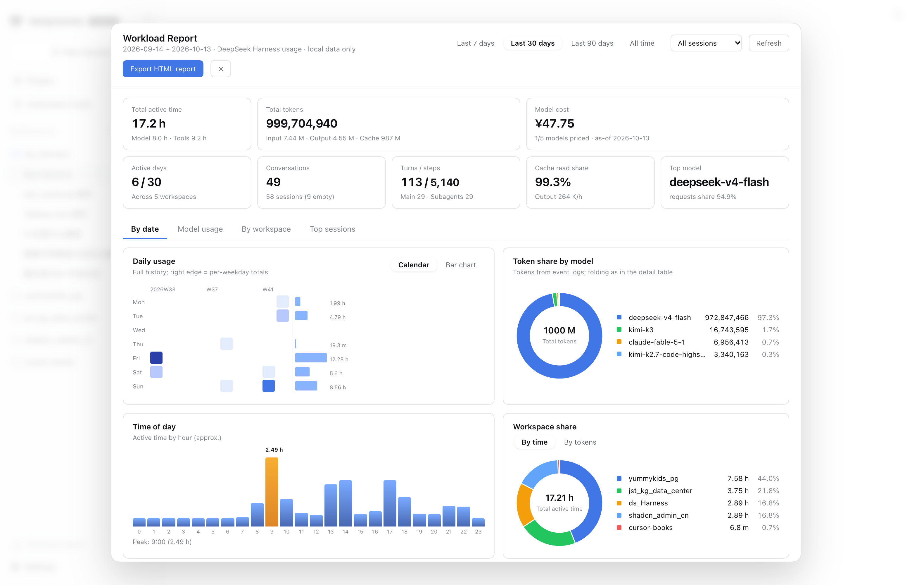
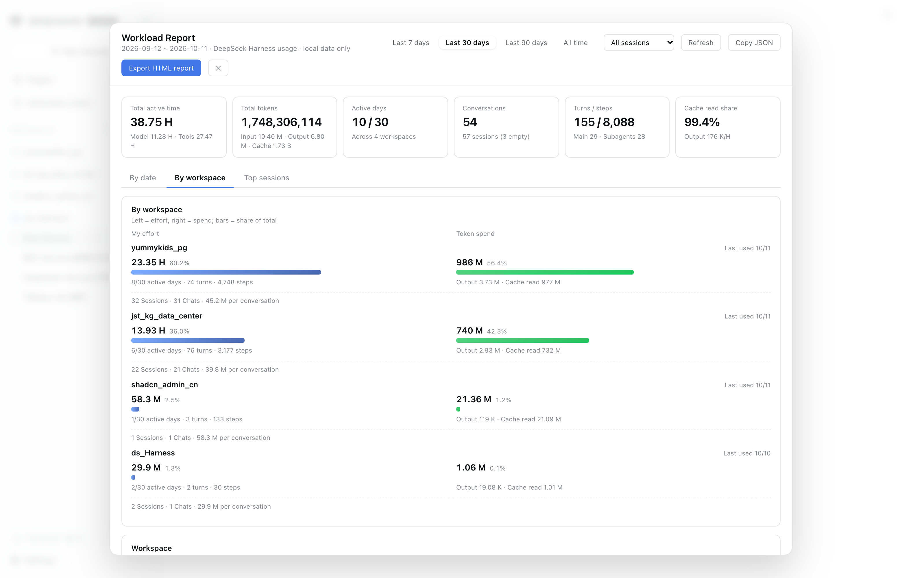

<!-- publish:skip -->
<table>
<tr>
<td width="56" valign="middle"></td>
<td valign="middle">

**作者：[XILEJUN](https://github.com/tableau-China)** · 2026-10-11

</td>
</tr>
</table>
<!-- /publish:skip -->

> 用 AI 干活的第 N 个月，我最怕两个问题：「你最近在忙什么？」和「这东西到底花了多少？」
> 前者我答得含糊，后者我根本没有数——不是没数据，而是数据散在几百个会话里，
> 而 Harness 只给我看**当前这一个会话**的统计行。

做这个插件有三个动机：

1. **我想更了解自己的开发过程。** 时间到底花在哪个项目上、一天里哪几个小时在状态、哪些项目在持续推进、哪些只是偶尔碰一下——这些我都想看得见，而不是凭感觉回忆。
2. **我要按项目给客户汇报进展。** "最近很忙"没有说服力；"这个项目占了我 46% 的投入、30 天里有 18 天在场、消耗了 3.7 B Token"才有。
3. **我一直在用最新的 DSH**（写这篇文章时是 `@deepseek-ai/dsh@0.2.1-alpha.2`），而不少公开插件对 alpha 版本的跟进偏慢，装上要么报错、要么少半边功能。所以干脆自己写一个：**只依赖官方接口、跟着新版本走**——"能跟上"本身就是我写它的理由之一。

于是我写了 [dsh-workload-report](https://github.com/tableau-China/dsh-workload-report)：把**「我的付出」与「Token 消耗」按日期、按工作区摊开**的 DSH 插件，并且能一键导出**一份可以直接发给客户的自包含 HTML 报告**。

## 它长什么样

侧边栏底部多一个入口，点开是全屏看板。首页六张 KPI：

- **活跃时长**（模型时间 + 工具执行时间）
- **总 Token**（完整整数，可核对，例如 2,690,929,214；K/M/B 只出现在小字里）
- **活跃天数** / **对话次数** / **轮次·步骤** / **缓存读取占比**



往下是三块图：

1. **日历热力图**（默认）：纵轴周一～周日、横轴 Year-Week，颜色深浅＝活跃时长。它**固定展示全部历史**，不随顶部区间筛选变化；最后一列右侧紧贴着 7 条横条，是各周几的累计活跃时长——一眼能看出「我哪几天在真的干活」。
2. **时刻分析**（左）：0–23 点，柱高＝该时段分摊到的活跃时长，最高的那根高亮。我自己最活跃的是 20:00 一带。
3. **工作区占比**（右）：Top 6 + 其他，可在「按时长 / 按 Token」之间切换。

而「按工作区」这个页签，是我最想给你看的部分：



每一行是**左「我的付出」右「Token 消耗」**：左边是活跃时长（小字给活跃天数 / 轮次 / 步骤），右边是 Token 总量（小字拆输出与缓存读取）。两条 bar 用**同一个口径**绘制——都按"占全部的比例"，所以旁边的百分比和 bar 长度说的是同一件事，横向、纵向都能直接比。

给客户解释工作量时，我终于可以不说"我很忙"，而是说："这个项目占了我 46% 的投入、30 天里有 18 天在场、消耗了 3.7 B Token。"

## 一份能直接发出去的报告

看板右上角「导出 HTML 报告」，产出的是**一个文件**：

- 内联 CSS + 内联 SVG，**没有任何外链、没有脚本**，双击就能开，可以直接发微信/邮件，也可以打印成 PDF；
- 支持浅色/深色两套配色，标题、备注可自定义；
- 加 `anonymize=1` 会匿名化工作区名并隐藏会话标题——给外部看时不必暴露项目代号。

报告里同样是「时刻分析 + 工作区占比 + 每日趋势 + 明细表」，还带了口径说明。对做月报、写博客的人来说，它天生适合截图。

## 数据从哪来：不解析日志，只读官方投影

DSH 已经把每个会话的统计算好了（`sessionStats`、`tokenUsage` 等投影）。插件的宿主半部只做一件事：**用官方接口把这些值取出来并聚合**，四层取值，先便宜后昂贵：

| 顺序 | 来源 | 成本 | 说明 |
| --- | --- | --- | --- |
| 1 | `ctx.sessionProjections.snapshot(session, keys)` | 同步、极低 | 活会话最准；订阅 `session/event` 增量更新 |
| 2 | `ctx.sessionProjectionCache.cachedSnapshot(header, keys)` | **零 I/O** | 读持久化投影检查点 |
| 3 | 本地索引 `<DSH_HOME>/workload-report/index-v*.json` | 一次磁盘读 | 覆盖第 2 层未命中的会话 |
| 4 | `ctx.sessionQuery.observeSession(id, { projectionMode: "all" })` | 冷读日志 | 官方折叠整份日志兜底，结果落盘复用 |

我刻意**没有**去解析 `session.jsonl.zstd`：格式会随版本演进，而投影的语义由 Harness 自己维护。代价是首次建索引要冷读历史会话（我这边 300+ 会话约 2 分钟，并发 8），换来的是后续重启亚秒级复用，以及「口径永远和 Harness 自己算的一致」。

> 开发过程中踩过的坑（投影的两种值形状、检查点随会话格式迁移作废、cordis 漏声明导致的实时路径静默失效、增量重扫的竞态……）都记在仓库的
> [CHANGELOG](https://github.com/tableau-China/dsh-workload-report/blob/main/CHANGELOG.md) 与
> [PROGRESS](https://github.com/tableau-China/dsh-workload-report/blob/main/PROGRESS.md) 里。那是一份开发记录，这里就不展开了。

## 口径与已知限制（我也写在插件里）

- **活跃时长是引擎累计工作时间**（模型 + 工具），并发会话与子代理各自累加，**不等于墙钟时长**；
- **对话次数** = 至少产生 1 个步骤的会话数，零步会话（只打开没交互）单列；
- **归属日期**按会话创建时间在所选时区计算，跨天续聊的活动记在创建那天；
- **时刻分析**的口径：会话活跃窗口 = 开始时间 → 最后一次用户提问时间，把该会话的引擎时长按墙钟重叠比例分摊到覆盖的小时；它是**近似值**（跨天续聊的长窗口会被摊薄）；
- 日历热力图固定展示全部历史，不跟顶部区间筛选变化；
- 极早期格式的会话可能读不到，界面会写明数量。

这些都写进了仓库的 [`docs/metrics.md`](https://github.com/tableau-China/dsh-workload-report/blob/main/docs/metrics.md)——给客户看的数字，口径必须先说清楚。

## 安装

```bash
dsh plugin --profile web add github:tableau-China/dsh-workload-report#main
```

构建产物 `lib/client.js` 已入库，**不需要本地构建**。装完重启 Web profile，侧边栏底部出现「工作量报告」。

想给客户看时改个名字（配置在 profile 的 `cordis.patch.yml`）：

```yaml
- id: workload-report
  name: dsh-workload-report
  config:
    workspaceAliases:
      my-shop-app: 零售订单系统
      data-platform: 数据中台
```

## 测试策略

插件类项目最难的不是写功能，而是**改完敢不敢重启**。这里堆了两层：

- **离线 124 项断言**：聚合口径、时区归属、时刻分摊守恒、"全部"档起点、日历数据源、HTML 转义、Token 两种形状、冷读兜底与复用、`inject` 声明检查、宿主路由 200/404/405、以及 **i18n 一致性**（中英键集一致、引用键必须存在、无死键、无超长文案）。
- **真实浏览器 E2E 61 项**：在**隔离实例**（独立 `DSH_HOME` + 端口，复制真实投影数据，不碰正在用的 GUI）里跑，含 DOM 断言与**几何断言**——比如"左块右边界 ≤ 右块左边界"来证明两块确实是左右并排而不是上下两行。

CI 每次 push 都会：安装依赖 → 构建 → **校验入库的 `lib/client.js` 与源码一致** → 跑离线断言。

## 最后

这个插件解决的不是"看数据"，而是**把付出说清楚**。对我而言，它顺手解决了三件事：写月报有数、给客户报价有据、以及——看到日历上那些空白的格子时，知道自己上周确实该休息了。

- 仓库：[tableau-China/dsh-workload-report](https://github.com/tableau-China/dsh-workload-report)
- 口径文档：[docs/metrics.md](https://github.com/tableau-China/dsh-workload-report/blob/main/docs/metrics.md)
- 许可：MIT
