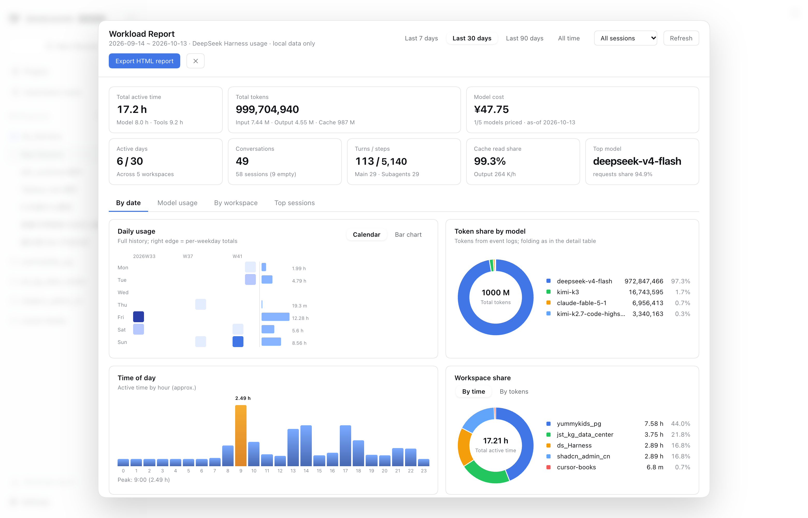

# Workload-Report für DeepSeek Harness (DSH): Token-Nutzung und Arbeitszeit

> **Arbeitszeit und Token-Verbrauch auf einen Blick** — nach **Datum** und **Workspace**: Kalender-Heatmap, Tageszeit-Analyse, Modellnutzung und ein **eigenständiger HTML-Report**, der sich direkt an Kunden senden lässt.
> Ein DeepSeek Harness (DSH)-Plugin. Aktuelle Version: **2.5.0**.

[](https://www.npmjs.com/package/dsh-workload-report)
[](../../LICENSE)
[](https://github.com/tableau-China/dsh-workload-report/actions)
[](https://nodejs.org)

[English](../../README.md) · [中文](./README.zh-CN.md) · [日本語](./README.ja.md) · **[Deutsch](./README.de.md)** · [Français](./README.fr.md) · [Español](./README.es.md) · [Русский](./README.ru.md) · [Português](./README.pt.md)



*Dashboard mit KPI-Karten, Kalender-Heatmap, Tageszeit-Analyse und Workspace-Anteilen.*

## Was es ist

DSH zeigt die Statistik der **aktuellen Session**; dieses DSH-Plugin ergänzt die sitzungs-, projekt- und zeitübergreifende Sicht: an welchen Tagen und in welchen Workspaces die Arbeitszeit gelandet ist, zu welchen Stunden produktiv gearbeitet wurde, welche Modelle die Token-Nutzung verursacht haben und was das etwa gekostet hat.

**Nicht nur Kosten, sondern die Arbeit dahinter.** Arbeitszeit, aktive Tage und Runden zeigen, was tatsächlich gemacht wurde; Token-Verbrauch und geschätzte Kosten zeigen, was dafür nötig war. Alle Ansichten und der exportierte Report verwenden dieselben Definitionen, damit die Zahlen zusammenpassen.

Der Report ist eine eigenständige HTML-Datei und lässt sich direkt an Kunden, Team oder für den Monatsrückblick weitergeben. Die Oberfläche ist mehrsprachig: Dashboard, Report, KI-Profil und Sync-Dialoge folgen der DSH-Sprache in 8 Sprachen.

## Funktionen

- **Arbeitszeit und Token in einer Ansicht**: aktive Zeit = Modellzeit plus Werkzeugzeit, Wartezeit auf Nutzer ausgeschlossen; daneben Token-Verbrauch und geschätzte Kosten.
- **Nach Datum, Workspace, Modell und Session**: Kalender-Heatmap (Mo–So × Kalenderwoche), Tageszeit-Analyse mit Token-Ausgabe oder Runden und Dichte der Nutzer-Nachrichten, Workspace-Anteile und eine sortierbare Session-Tabelle.
- **Modellnutzung im Detail**: Geschwindigkeit in tok/s, TTFT, Cache-Treffer, Anfragen und geschätzte Kosten – letztere nur für Modelle mit offiziell veröffentlichten Preisen.
- **Eigenständiger HTML-Report**: eine Datei mit Inline-CSS und Inline-SVG, ohne Skripte und externe Assets, hell/dunkel, mit optionaler Anonymisierung (`anonymize=1`) für Workspace-Namen und Session-Titel.
- **KI-Nutzerprofil (manuell)**: Headline, 4–6 Dimensionen mit Zahlenbelegen, 2–3 Empfehlungen und Risikohinweis – nur aus Aggregatstatistiken und erst nach Klick auf „Profil erstellen“; bei Fehlern greifen lokale Regeln.
- **Multi-Device-Sync (optional, standardmäßig aus)**: mehrere Rechner über Tencent COS, GitHub, Gitea oder einen geteilten Ordner zusammenführen; übertragen werden nur aggregierte Zeilen pro Session.
- **8 UI-Sprachen**: Deutsch, Englisch, Chinesisch, Japanisch, Spanisch, Französisch, Russisch und brasilianisches Portugiesisch; die Sprache folgt der DSH-Oberfläche.
- **Nur offizielle Schnittstellen, standardmäßig keine ausgehenden Anfragen**: die Statistiken bleiben lokal; das Plugin registriert nur lesende HTTP-Routen und schreibt nur seinen eigenen lokalen Index und den optionalen Profil-Cache.

## Installation

```bash
# über npm
dsh plugin add dsh-workload-report

# oder direkt von GitHub
dsh plugin --profile web add github:tableau-China/dsh-workload-report#main
```

Nach einem Neustart des Web-Profils erscheint der Eintrag **unten in der Seitenleiste**: **Workload-Report**. Die Beschriftung folgt der DSH-Sprache. Das fertige Client-Bundle (`lib/client.js`) ist bereits eingecheckt, eine lokale Build-Umgebung ist für die Installation nicht nötig.

Der Stand ist durch 1738 Offline-Tests und eine i18n-Prüfung über alle 8 Sprachdateien abgesichert.

## Links

- [Englisches README](../../README.md)
- [Chinesisches README](./README.zh-CN.md)
- [Metrik-Definitionen](../metrics.md)
- [i18n-Architektur und Wartung](../i18n.md)
- [Multi-Device-Sync](../sync.md)
- [CHANGELOG](../../CHANGELOG.md)
- [Blogbeitrag](https://vizwise.cn/posts/dsh-workload-report)
- [Lizenz (MIT)](../../LICENSE)

**Suchbegriffe**: DeepSeek Harness Plugin, DSH Workload-Report, Token-Nutzung, Nutzungs-Dashboard, Arbeitszeit-Report, Workspace-Statistik, Modellnutzung, HTML-Report, Multi-Device-Sync, KI-Nutzerprofil
