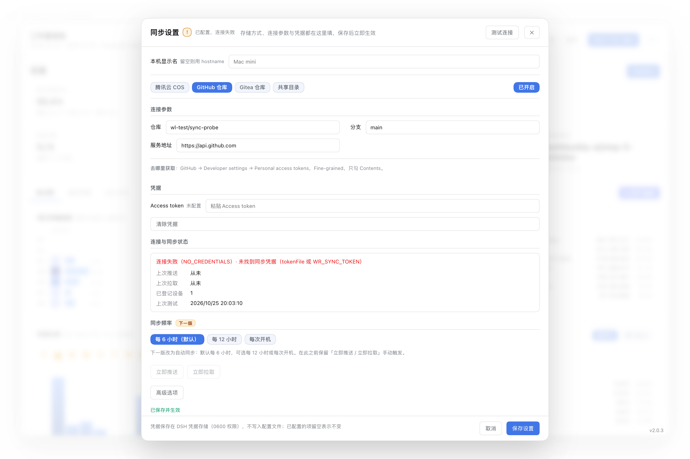

# 多设备用量合并

> **状态：已实现（2.0.0）。** 原先标记「暂缓」是因为通用性弱；公开版把传输层做成可插拔后，
> 任何用户都能用自己的存储（腾讯云 COS / GitHub / Gitea / 共享目录）同步自己的多台设备。

## 目标与默认行为

| 原则 | 说明 |
| --- | --- |
| **默认零配置、零外发** | 不配 `sync.enabled` 时，行为与不含该功能的版本**完全一致**：只读本机，不联网 |
| **默认合并多机** | 配好来源后，KPI／日历／时刻／工作区默认汇总全部机器 |
| **可按设备筛选** | 看板设备筛选 chips（多选），或 API 参数 `?machine=<id\|name>`（可重复） |
| **机器名自动** | 优先 `hostname`，可用 `sync.machineName` 覆盖；**本机不需要任何设置** |
| **只同步统计行** | 传「逐会话汇总行」，不传原始会话日志、不传对话内容 |

## 一、机器身份

- **`machineId`（稳定）**：读 `<DSH_HOME>/.anonymous-user-id`（DSH 每台安装一个随机 UUID，
  不含机器或账户信息）；读不到时退回 `sha1(hostname + DSH_HOME)`。
- **`machineName`（展示）**：`sync.machineName ?? os.hostname()`，去掉 `.local` 后缀。
- 载荷携带 `machine: { id, name, host, platform, arch, plugin }`，来源天然可区分。
- **冲突**：每台机器只写自己那一个 key（`path` 模板含 `{machineId}`），路径不重叠 → **天然无冲突**。

## 二、同步载荷

与插件内部行结构**完全一致**，合并端无需转换：

```json
{
  "schema": 1,
  "kind": "dsh-workload-report/rows",
  "generatedAt": 1791125942708,
  "machine": { "id": "6311…", "name": "Mac mini", "host": "x.local", "platform": "darwin", "arch": "arm64", "plugin": "2.0.0" },
  "totals": { "sessions": 313, "activeMs": 1003379000 },
  "rows": [
    {
      "id": "session-2fdda78e-…", "createdAt": 1790784271748,
      "cwd": "/Users/me/proj", "isSubagent": false, "isSeeded": false, "agentPreset": "standard",
      "title": "…", "turns": 12, "steps": 34,
      "llmMs": 123456, "toolMs": 23456, "waitMs": 0, "decodeTokens": 18900,
      "tokens": { "input": 7269, "output": 188, "cacheRead": 6144, "cacheWrite": 0 },
      "lastPromptAt": 1791125946521, "asOfSeq": 172,
      "models": {}, "hours": [], "hourTokens": [], "hourHumanMsgs": [],
      "updatedAt": 1791167399954
    }
  ]
}
```

- **体积**：约 1 KB/会话（含模型与时刻分布）→ 300 会话 ≈ 300 KB。
- **幂等**：按 `row.id` 合并——**本机行永远优先**（本机投影最准），只在**远端之间**按 `updatedAt` 大者胜；重复上传／拉取不会重复计数。
- **本机优先**：同一 id 在本机与远端都有时保留本机行（本机投影最准）。
- **不含**：对话内容、提示词、工具调用参数、附件。

## 三、在 GUI 里配置（推荐）

打开看板 → 设备筛选行右侧的「设备同步」按钮 → **直接弹出唯一的大弹窗**（920px）。
没有中间页面、也没有二层弹窗：**原来的「设备同步」页已并入这里**。

```
┌ 同步设置  ○ 尚未配置                         [测试连接]  ✕ ┐
│ 本机显示名  [Mac mini]                                      │  ← 全局项
├────────────────────────────────────────────────────────────┤
│ [腾讯云 COS][GitHub 仓库][Gitea 仓库][共享目录]      [已关闭] │
├────────────────────────────────────────────────────────────┤
│ 连接参数                                                    │
│  仓库 [owner/name]        分支 [main]                       │  ← 左标题 + 右输入框
│  服务地址 [https://api.github.com]                          │
│  去哪里获取：…                                              │
├────────────────────────────────────────────────────────────┤
│ 凭据                                                        │
│  Token [粘贴 Token]                                        │
├────────────────────────────────────────────────────────────┤
│ 连接与同步状态                                              │
│  尚未测试连接（保存后会自动测一次）                          │
│  上次推送 从未 / 上次拉取 从未 / 已登记设备 0 / 上次测试 从未 │
├────────────────────────────────────────────────────────────┤
│ 同步频率  [下一版]                                          │
│  (每 6 小时) 每 12 小时 每次开机        ← 后两个置灰         │
│  [立即推送] [立即拉取]                                      │
├────────────────────────────────────────────────────────────┤
│ [高级选项]  ← 只有「文件路径模板」                           │
├────────────────────────────────────────────────────────────┤
│ 凭据存 0600 文件…                        [取消] [保存设置]  │
└────────────────────────────────────────────────────────────┘
```


### 1. 弹窗里的区域

| 区域 | 内容 |
| --- | --- |
| **标题旁的状态图标** | `✓` 已配置且连接正常 ｜ `!` 已配置但连接失败 ｜ `○` 已配置未开启 / 已开启未测试（虚线）/ 尚未配置。图标旁始终有一行文字说明 |
| **已登记设备**（第一部分，与本机显示名并列） | 本机 + 远端设备的 chips；下面常驻一行「设备身份按安装 ID 识别（xxxxxxxx…），改显示名不会中断数据」 |
| **本机显示名**（全局） | 只设一次，对四种存储方式都生效；留空用 hostname |
| **存储方式 + 开启同步** | 腾讯云 COS / GitHub 仓库 / Gitea 仓库 / 共享目录；右侧开关 |
| **连接参数**（左标题 + 右输入框） | COS：存储桶 / 地域；GitHub·Gitea：仓库 + 服务地址（左列）· 分支（右列）；共享目录：目录路径 |
| **凭据**（默认展开，每字段一行） | COS：SecretId / SecretKey；GitHub·Gitea：Token；共享目录：不需要凭据 |
| **连接与同步状态** | **一行**：大号状态徽标 + 结论 + 「上次推送 · 上次拉取」；失败时多一行原因。成功时保持单行 |
| **同步频率**（2.2.0 起可用） | 每 6 小时 / 每 12 小时 / 每次开机 / 仅手动；每个选项都标注"会怎样同步"；保存后定时器立即按新频率重建 |
| **高级选项**（直接显示） | 「文件路径模板」**只读**展示实际 key（如 `machines/4fd7a959.json`），并说明文件位于同步存储的 `machines/` 目录下 |

### 1a. 设备身份：改名字不会断数据

设备身份**不是**显示名，而是 `<DSH_HOME>/.anonymous-user-id`（每台安装一个随机 UUID）：

| 东西 | 会不会因改名而变 |
| --- | --- |
| `machine.id`（载荷里的设备 id） | **不变** |
| `{machineId}` 路径 / 远端对象 key | **不变** |
| 按 id 的设备合并与去重 | **不变** |
| `machine.name`（展示名） | 变（只是标签） |

界面为了让人放心，做了三件事：

1. 第一部分常驻显示「设备身份按安装 ID 识别（xxxxxxxx…）」；
2. 改名字保存成功后提示「已改名：A → B；设备 ID（xxxxxxxx…）没变，历史数据继续合并」；
3. **防回归校验**：保存时比对基准 id 与当前 id，若变了（换了 DSH 账户 / `DSH_HOME` / 删了 id 文件）
   **拒绝保存**并说明「继续保存会把历史数据拆成两台设备」。

### 1c. 文件到底写到哪（路径只读展示）

- 默认 `sync.path = machines/{machineId}.json` → 文件在**同步存储的根**下的 `machines/`：
  COS 是 `桶根/machines/<id>.json`，GitHub/Gitea 是 `仓库根/machines/<id>.json`。
- **与 `dsh-workload-report` 目录无关**（`machines/` 不是它的二级目录），也不在 `<DSH_HOME>/workload-report/` 下
  ——那里只是本机缓存与凭据文件。
- 想要二级前缀，手改配置 `sync.path: dsh-workload-sync/machines/{machineId}.json`，
  界面上的路径预览与目录说明会自动跟着变。

### 1b. 测试连接：配置后立即测试

- 头部「**测试连接**」按钮：随时手动重测（未开启同步时置灰，提示先开启）。
- **保存后自动测一次**（开启同步时）：结果同时写进状态区与标题图标，所以「配好就能立刻知道通不通」。
- 失败示例：状态区显示 `连接失败（NO_CREDENTIALS）· 未找到同步凭据`、图标变 `!`。



### 1d. 自动同步频率（2.2.0）

用户只选一个「多久同步一次」，插件内部换算成推送 / 拉取周期：

| 频率 | 推送 | 拉取 | 启动时 |
| --- | --- | --- | --- |
| 每 6 小时（默认） | 6h | 30 分钟 | 先同步一次 |
| 每 12 小时 | 12h | 30 分钟 | 先同步一次 |
| 每次开机 | 仅启动一次 | 仅启动一次 | 同步一次，运行期间不跑 |
| 仅手动 | 无定时器 | 无定时器 | 不同步 |

- 配置项：`sync.syncFrequency`（`6h | 12h | boot | manual`，默认 `6h`）。
- 换算逻辑集中在 `frequencyPlan()`（`src/client/sync-state.js`）：返回
  `{ pushEveryMs, pullEveryMs, timer, runOnStart }`；**只有周期型频率才建定时器**。
- **保存即生效**：`/sync/settings` 写入 `syncFrequency` 后宿主调用 `syncTimers.refresh()`
  重建定时器，不需要重启 DSH。
- 拉取恒为 30 分钟：拉取是只读且便宜的，但要看到别的机器的新数据，拉取必须比推送频繁。
- **手动「立即推送 / 立即拉取」只在选中「仅手动」时出现**，就排在那四个频率选项后面（2.2.1 起）。
  自动同步的三种频率下不显示——它们本来就会自己跑，不需要额外按钮。

### 2. 一次保存做了什么

点「保存设置」= 一次提交，按顺序：

1. **写设置**（`POST /sync/settings`）→ DSH 官方 `configEditor.edit()`：先校验完整候选值、加 profile 文件锁、
   原子替换、保留 YAML 注释，然后由 Loader **热应用**（传输方式、设备名、后台推送/拉取周期立刻跟随）。
   只把**非默认值**写进 YAML（`slimConfig`），切换存储方式**不会清空**其它方式的配置。
2. **写凭据**（`POST /sync/credentials`，仅当填了新值或点了「清除凭据」）→ DSH 凭据存储，并自检一次连接。
   连接不通时提示「设置已生效，但连接失败：…」，不会误报整次保存失败。

设置失败就停下，不写凭据（写了也连不上）。

### 3. 凭据存在哪（0600 权限 + 文件锁）

**不需要开终端。** 直接粘贴，界面只显示「已配置 / 未配置」。

#### 存到哪里了

存进 **DSH 自带的加密凭据存储**（`@deepseek-ai/dsh-credentials`，服务名 `credentials`），
记录 key 形如 `dsh-workload-report/cos-secret-id`。它带来这些保证：

| 保证 | 说明 |
| --- | --- |
| 不进配置文件 | profile 里只有 bucket / region 这类非机密项 |
| 不进 git | 不会跟着 dotfiles 被提交 |
| 不进浏览器 | 提交后输入框立即清空，不用 localStorage |
| 原子写 + 文件锁 | 底层是 DSH 维护的 0600 文件（`writeFileAtomic` + `withFileLock`） |
| 界面不回显 | `describeRecord` 只回答 `{ configured, kind, writable }`，**从不返回值** |
| 可随时清除 | 「清除凭据」按钮 → 保存后调用 `deleteRecord`（按钮先变成「将清除凭据」待办态） |

当前 DSH 没有 `credentials` 服务时，插件退化为自管 `<DSH_HOME>/workload-report/credentials.json`（0600），
对话框里会有一行提示说明这一点——仍然不需要手改配置。

### 4. 设备列表

2.0.3 起没有独立的「设备同步」页面，弹窗里的「连接与同步状态」只给**已登记设备数**。
「哪台设备什么时候同步过」仍由看板上方的**设备筛选 chips** 表达（`stale` 用虚线圈标出）；
需要逐台明细时看 `/sync` 路由返回的 `status.devices`。

### 回退顺序

同一个字段按下面顺序取值，前面的优先：

1. **DSH 凭据存储**（GUI 里填的；宿主以 0600 权限写入 `<DSH_HOME>/.credentials.yaml`，带文件锁）
2. **凭据文件**（0600，适合无 GUI 的服务器）
3. **环境变量**（CI / 脚本）
4. **配置内联**（不推荐，仅为兼容旧配置）

所以你已经用文件配好凭据时，GUI 会显示「已配置 · 来自凭据文件」，不会要求你重填。
空提交**不会**覆盖已存的值——要清空请用「清除凭据」。

### 老版本 DSH

- 没有 `credentials` 服务 → 表单提示「当前 DSH 版本没有加密凭据存储」，仍可用文件或环境变量。
- 没有 `configEditor` 服务 → 「保存设置」置灰并提示手动编辑 `cordis.patch.yml`。

## 四、凭据文件（无 GUI 场景）

### COS

```yaml
config:
  sync:
    enabled: true
    transport: cos
    cos:
      bucket: my-sync-1250000000     # 必须带 APPID 后缀
      region: ap-guangzhou
      secretIdFile: ~/.dsh/.cos-id    # 0600
      secretKeyFile: ~/.dsh/.cos-key  # 0600
```

- **签名**：COS 自有的 **`q-sign-algorithm=sha1`**（**不是**通用云 API 的 TC3-HMAC-SHA256——
  对 `cos.<region>.myqcloud.com` 用 TC3 会一律返回 `403 AccessDenied`）。
  手写实现（`src/cos-sign.js`，只用 Node 内置 `crypto`），已与官方测试向量的 SignKey、
  HeaderList、HttpString 的 SHA1 逐段对齐；插件保持 **0 runtime dependencies**。
- **关键细节**：签名用的 `UriPathname` 是**解码后**的路径，实际发请求用编码后的路径；
  两者混用会 `SignatureDoesNotMatch`。
- **桶必须私有**（载荷含 `cwd` 绝对路径）。
- **最小权限策略**（子账号，别用主账号密钥）：

```json
{
  "version": "2.0",
  "statement": [{
    "effect": "allow",
    "action": ["cos:PutObject", "cos:GetObject", "cos:HeadObject", "cos:ListParts", "cos:GetBucket"],
    "resource": [
      "qcs::cos:ap-guangzhou:uid/1250000000:my-sync-1250000000/*",
      "qcs::cos:ap-guangzhou:uid/1250000000:my-sync-1250000000/"
    ]
  }]
}
```

> `resource` 必须**同时**包含桶本身和 `/*`：只写 `/*` 会让 `GetBucket`（列对象）失败。

### GitHub / Gitea

```yaml
    transport: github        # 或 gitea
    github:
      baseUrl: https://api.github.com    # 自建 Gitea 填 origin，如 https://git.example.com
      repo: zhangsan/my-workload-sync    # 必须私有
      branch: main                       # Gitea 常见 master
      tokenFile: ~/.dsh/.sync-token      # fine-grained PAT，仅 Contents: Read and write
```

### 共享目录（零凭据）

```yaml
    transport: local
    local:
      dir: ~/Library/Mobile Documents/com~apple~CloudDocs/dsh-sync
```

配合 iCloud Drive / Syncthing / NAS 使用：不需要任何账号，数据不出本地同步网络。
适合企业内网或不想开云账号的场景。

### 手动指定来源

> 「按 URL 指定只读来源」（`sync.sources: [{ key, url }]`）**尚未实现**：当前只支持按 `path` 模板列举目录。


## 五、合并语义与展示

**索引分层**：本机行放 `rows`，每个来源单独存 `sources[key] = { payload, fetchedAt, key }`。
来源被禁用或远端文件被删即整体丢弃（`pull` 会同步移除已消失的来源，无残留）。

**为什么合并「逐会话行」而不是「已聚合报告」**：后者会算错交叉指标——
例如两台机器同一天都做了同一个项目，把两份 `byWorkspace.activeDays` 相加会把「1 天」算成「2 天」。
按会话行合并后，活跃天数（按天去重）、时刻分摊、工作区×天 都仍然正确。

| 维度 | 默认（合并） | 设备筛选 |
| --- | --- | --- |
| 8 项 KPI | 多机相加 | 只看选中设备 |
| 日历热力图 / 每日趋势 | 多机相加（同日自动合并） | 同上 |
| 时刻分析（0–23） | 多机相加 | 同上 |
| 工作区占比 / 对照 | 见下方「工作区合并」 | 同上 |

**设备筛选**：API `?machine=<id|name>`（可重复），`machine=local` 只看本机；
看板顶部 chip 多选，默认「全部设备」。本机行永远参与（除非远端被显式选中且排除本机）。

**工作区合并**：现状 `byWorkspace` 的 key 是完整 `cwd`，别名只改显示名——
两机同项目若路径不同会显示成两行。配 `workspaceAliases` 后按 label 合并成一行。

## 六、看板 UI

看板新增「设备同步」入口：**设备筛选 chips 同一行的右侧**（不再是顶部页签，也不在 AI 画像之后）。
`sync.enabled=false` 时同样保留入口——同步设置就在这一页，用户要从这里进去开启：

2.0.3 起**没有单独的同步页面**：入口按钮直接打开大弹窗，配置、凭据、状态、测试与手动同步都在里面
（见第三节的表格）。看板上仍在设备 chips 右侧保留入口按钮；同步关闭时按钮同样可点，
打开弹窗即可开启。

顶部 KPI 区域上方是**设备筛选 chips**（多选，默认「全部设备」）；「设备同步」入口就在这行 chips 的右侧。

## 七、隐私与安全

1. **默认关闭**；未配置 `sync.enabled` 时插件**不产生任何外发请求**（离线断言覆盖）。
2. 载荷不含对话内容；含 `cwd` 绝对路径 → **必须用私有桶 / 私有仓库**。
3. 凭据默认存 **DSH 凭据存储**（GUI 填写）：宿主用 0600 权限 + 文件锁写入 `<DSH_HOME>/.credentials.yaml`，**不是应用层加密**——真正的静态加密依赖磁盘加密（macOS FileVault / Windows BitLocker）。也可改用 0600 凭据文件或环境变量。
   界面只显示「已配置」与来源，**从不回显内容**；空提交不覆盖已存值；日志只记「保存了 N 项」。
4. `redactPaths: true`：`cwd` 以别名或「名字#短哈希」代替，适合发布到共享通道。
   **界面上不再提供该开关**（含义难以理解，默认即为关闭）；需要时手改配置。
5. 最小权限：COS 只授单个桶的 `machines/*` 前缀；GitHub 用 fine-grained PAT 只授权单仓库。

## 八、配置项总表

| 键 | 默认 | 说明 |
| --- | --- | --- |
| `sync.enabled` | `false` | 总开关（false 时零外发） |
| `sync.mode` | `push+pull` | `push+pull` \| `push` \| `pull` |
| `sync.transport` | `github` | `cos` \| `github` \| `gitea` \| `local` |
| `sync.path` | `machines/{machineId}.json` | key 模板，支持 `{machineId}` / `{machineName}` |
| `sync.machineName` | `os.hostname()`（去 .local） | 展示名 |
| `sync.syncFrequency` | `6h` | 自动同步频率：`6h` \| `12h` \| `boot` \| `manual`（2.2.0） |
| `sync.pushEveryMs` | 6h | 推送周期（最小 60s；由 `syncFrequency` 自动推导，手改仍生效） |
| `sync.pullEveryMs` | 30m | 拉取周期（最小 60s） |
| `sync.timeoutMs` | 15000 | 单请求超时 |
| `sync.staleAfterMs` | 24h | 来源多久没拉到算过期（仅展示） |
| `sync.redactPaths` | `false` | 抹掉 cwd 绝对路径（**仅配置项，界面不展示**） |
| `sync.cos.*` | — | `bucket` / `region` / `secretIdFile` / `secretKeyFile` |
| `sync.github.*` | — | `baseUrl` / `repo` / `branch` / `tokenFile` |
| `sync.local.*` | — | `dir` |

环境变量兜底：`WR_COS_SECRET_ID` / `WR_COS_SECRET_KEY` / `WR_SYNC_TOKEN` / `GITHUB_TOKEN`。

## 九、验收标准

1. 不配置 `sync` → 行为与此前版本一致（离线断言）。
2. 两台机器各传一份 → 合并总量 = 两台之和；同一 `id` 只计一次。
3. 禁用/删除来源 → 总量立即回落，无残留。
4. 来源过期 → 仅该来源标记 stale，本机数据不受影响。
5. 同一项目同一天在两台机器都有活动 → **活跃天数不重复计天**。
6. 私有桶/仓库可读写；无凭据时不启用来源（`probe` 返回明确错误码）。
7. 离线断言：载荷校验、按 id 去重、跨机合并、`machine` 筛选、来源失效处理、COS 签名正确性；
   UI 结构断言：设备筛选 chips 与「设备同步」入口同处一行（入口在 chips 右侧），顶部页签行不再有设备同步页签；
   设置与凭据在同一个对话框、表单两列、路径模板收在默认收起的高级选项里、无「抹掉路径」、只有一个保存按钮。

## 十、版本计划

| 版本 | 内容 |
| --- | --- |
| **2.0.3**（本版） | 「设备同步」合并为唯一大弹窗、测试连接内置且配置后自动测试、配置状态图标（✓/!/○）、同步频率预留（默认 6 小时；12 小时 / 开机置灰待下一版） |
| 2.0.2 | 同步设置与凭据合并进一个对话框、表单左右两列、「文件路径模板」收进高级选项、「抹掉路径」不再展示、面板右下角显示版本号 |
| 2.0.0 | 机器身份 + 载荷 + COS/GitHub/Gitea/local 四传输 + 合并 + 设备筛选 + 设备同步入口 + 测试 + 本文档 |
| 1.2.0+ | 按机器拆分展示、WebDAV 传输、设备筛选记忆 |
